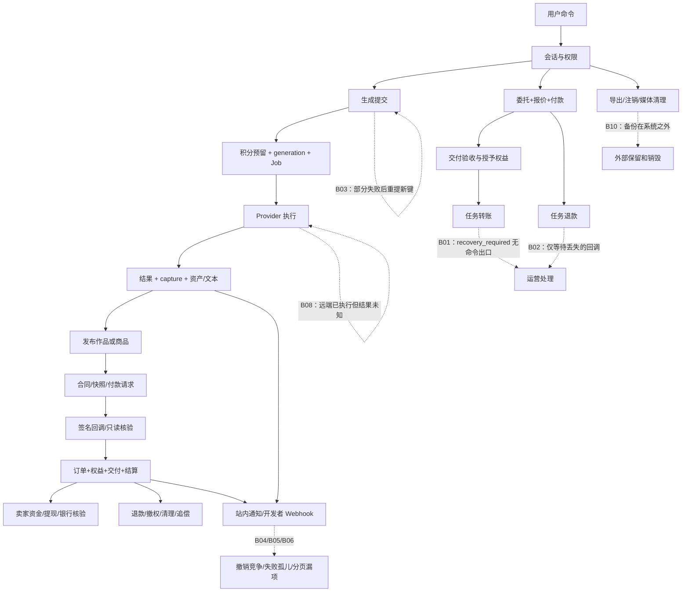
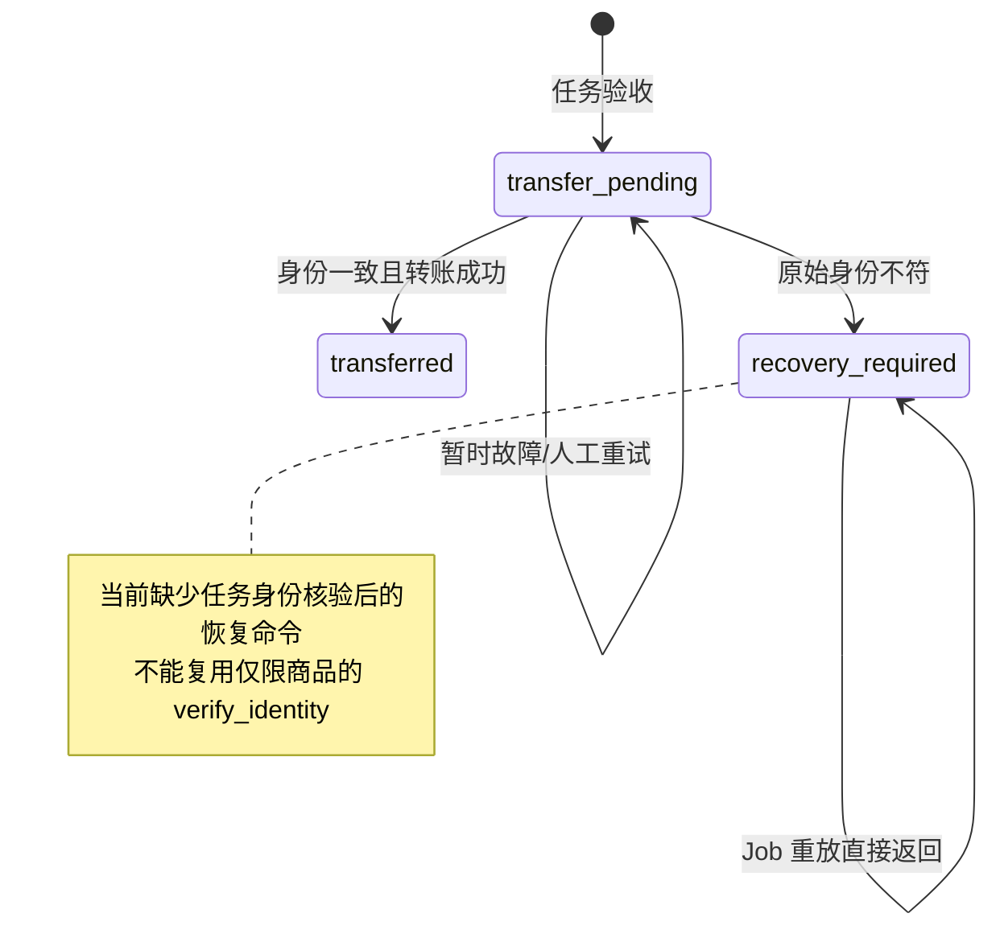

# HCAI-Chat 业务闭环审计

日期：2026-10-04。对象：当前工作区。配套：[项目架构复盘](project-review-20261004.md)。

## 1. 审计口径与业务全景

已完整读取附件 pasted-text-1.txt。本阶段遵循其中“但不要直接修改代码”的要求，只核验代码、运行现有测试、记录业务缺口与建议。没有真实扣款、退款、发货、发邮件或删除生产数据。

本文区分三种结论：

- **确认缺口**：可从实际读写条件和调用链推出具体失败场景；不意味着已在生产发生。
- **业务/运营边界**：代码有明确处理，但仍需人工、外部履约或业务规则才能结束。
- **待确认**：需要外部 Provider 能力、部署证据、故障注入或生产数据，不能凭文件名认定成功/失败。

业务由四条价值链组成：

1. 身份 → 订阅/积分 → AI 创作 → 资产 → 展示/复用。
2. 卖家资产 → 审核上架 → 买家付款 → 合同交付 → 退款/争议 → 卖家结算/提现/追偿。
3. 委托发布 → 报价/资金 → 指派 → 制作交付 → 验收/仲裁 → 创作者转账。
4. 用户操作与交易 → 通知/开发者回调/客服 → 运营恢复 → 隐私导出/删除/保留。

最重要的认知：业务对象、异步 Job 和外部事实有不同的终态。accepted 不等于到账；refund_pending 不等于退款；notification delivered 不等于已读；data rights completed 不等于备份已消失。

## 2. 闭环地图

图中的虚线是核查到的失败边界，不表示正常业务一定失败。商品主链有较完整的快照、补偿与对账实现；任务支付及辅助异步链的恢复不具有相同覆盖率。

## 3. 业务闭环审计表

“代码闭环”表示存在正常和指定异常出口，不代表真实外部环境已验收。

| 业务 | 发起者/起点 | 数据与正常处理 | 结束事实 | 异常、重试、人工 | 当前结论 |
|---|---|---|---|---|---|
| 邮箱登录/注册 | 用户输入邮箱与验证码 | challenge → 投递 Job → 校验次数/过期/hash → 用户/Session | challenge 消费且会话创建 | 过期、错误码、次数限制；重新申请；邮件投递依赖 Worker | 主要代码路径闭环；真实送达待验 |
| 验证邮箱/重置 | 用户申请 action 链接 | 加密 token、action、投递/过期 Job → consume | 身份字段改变且 token 失效 | dead letter 目录、管理员重试/撤销、过期；SMTP 重复送达可能 | 代码闭环，不保证信件恰好一次到达 |
| 钱包充值/订阅 | 用户选择额度/套餐 | Billing checkout 请求/合同 → 验真回调 → wallet 或 subscription/points | 原支付唯一对应入账与订阅权益 | 请求证据与身份绑定；未知结果需核实；回调可重放 | 正常链闭环；无回调时的主动核验覆盖需扩充，见 B07 |
| AI 生成 | 创作界面/API | command → reservation → execution/job → Provider → 文本或媒体/账目 | succeeded 或失败/取消并释放预留 | 租约、恢复扫描、失败证据；前端部分成功 B03；远端成本 B08 | 本地状态恢复较完整，端到端非 exactly-once |
| 上传扫描 | 用户上传 | command → write journal → 对象 → asset/scan Job | clean 可用或拒绝/终止失败 | 意图清理、扫描恢复、账户锁、限额与摘要校验 | 主要代码路径闭环，Scanner 实际能力待验 |
| 内容发布/社区 | 用户草稿/资产 | clean+归属+类型 → work/post；评论/关注/举报 | 公开或删除/治理处理 | 版本、重复命令、举报→风险→人工裁决 | 代码有人工闭环；运营响应时限待定 |
| 商品上架 | 卖家资产/许可/价格 | draft/review/publication → 可售 offer | 可售或拒绝/撤回 | 审核与权限、合同版本、原件约束 | 代码有闭环；内容和授权证据真实性由业务承担 |
| 商品购买 | 买家接受许可并 checkout | 冻结合同/交付快照 → Provider → 订单+权益+资产+结算 | fulfilled 且授权内容可读 | 身份与证据冲突停止；迟到付款/无法交付补偿；核验/定位/修复入口 | 有明确闭环设计，不应笼统归为断链 |
| 商品退款 | 买家/运营 | refund operation → Provider → 回调/查询 → 撤权/订单/结算/清理 | refunded，后续清理和资金追回可追踪 | refund attempts、只读 checks、恢复和历史证据 | 代码覆盖较广；已下载字节不可召回 |
| 卖家资金/提现 | 卖家与运营 | 资金资格、reservation、review、funding、bank payout、checks | 银行 paid 或失败释放/退回/追偿 | 未知证据冻结、恢复命令、原始账户绑定 | 多阶段闭环；真实到账与退回待验 |
| 委托资金/分派 | 委托人/创作者 | task/proposal → checkout/paid → assigned | 正确资金绑定正确委托和收款人 | open 到期取消；迟到成功排队退款；checkout 恢复缺口 B07 | 正常闭环，部分未知结果缺出口 |
| 委托交付/验收 | 创作者与委托人 | delivery → Review → accepted+grant+settlement+transfer Job | 交付可访问；资金需另看 transferred | revision/dispute/admin 仲裁；任务异常身份 B01 | 交付和钱分开闭环；资金有确认缺口 |
| 任务取消退款 | 委托人/到期/仲裁 | cancelled → refund_pending → 外部退款 | refunded | 无 refund ID 可重试，有 ID 则等回调；B02 | 回调丢失时不完整 |
| 任务争议 | 参与者 | disputed+risk+通知 → admin ResolveTaskDispute | accepted 或 cancelled，进入资金后续 | 版本、原因、参与者；无自动时限升级 | 人工出口存在，时限/责任 B09 |
| 站内通知 | 领域事务 | notification+Job → delivered/suppressed → 已读 | 用户可见/主动抑制，read_at 表示阅读 | 最终 Job 失败 B05、同时间戳分页 B06 | 不完整 |
| 开发者 API | 用户/管理员 | service account+hashed key+scope/IP/TTL → Principal | 有效授权或撤销/到期拒绝 | version、控制开关、用户状态 | 认证代码有闭环；端点覆盖以实际路由为准 |
| 开发者 Webhook | 领域事件 | immutable event→delivery→HMAC HTTP→attempt | succeeded/dead_letter/cancelled | 重试/管理员重放；撤销竞争 B04、最终死亡 B05 | 正常闭环，竞态与死亡分支不完整 |
| 客服 | 用户求助 | support case+message+resource → assigned operator | resolved/closed | 客户回复/状态流转、版本；不自动执行退款 | 工单闭环与实际问题解决是两层 |
| 风险治理 | 举报/争议/扫描等 | source_key 信号+规则版本 → review | reviewed/resolved 等领域结果 | 人工判断与审计；不自动实现资金裁决 | 代码具备入口；规则有效性需业务验证 |
| 成本对账 | 管理员 | 请求时间范围 → 本地成本+外部汇总 → 差异记录 | 报告生成或失败 | bounded Provider query、阈值、Job 重试 | 报告闭环，不是自动找回每个丢失生成 |
| 数据导出 | 用户再次确认身份 | request/job → 有限额的包与 checksum | ready 可下载→到期清除 | 导出失败投影/管理恢复、期限与权限 | 代码闭环，真实存储待验 |
| 注销/删除 | 用户；保留由运营设置 | 宽限→hold 检查→去标识→物理清理→回执 | 主数据清理完成 | 可取消、hold 到期扫描、清理恢复；备份 B10 | 主系统闭环，备份/第三方未闭环 |

## 4. 确认问题与可复现条件

### B01 [P1] 任务付款进入 recovery_required 后没有对应业务恢复命令

分类：A 业务闭环、B 状态逻辑、F 跨模块、G 人工流程。

**调用链与证据**

- tasks.Review 将验收任务关联付款置 transfer_pending，写 payment.transfer_task；admin.ResolveTaskDispute 也会进入该资金链。
- internal/payments/workflow.go:1865 HandleTaskTransferJob 在原商户/环境/端点/版本或收款目标身份不符时，将付款改为 recovery_required，记录 reconciliation_required 事件。再次执行遇此状态直接提交返回，不重新核验恢复。
- workflow.go:2017 HandleTaskRefundJob 对身份不符作相同安全停止。
- internal/admin/payment_operations.go:499 recoverPayment 只允许 retry_transfer 对 transfer_pending；任务 retry_refund 只允许 refund_failed 或没有退款 ID 的 refund_pending。verify_identity/check_checkout/locate_checkout 分支均限定 purpose=product。
- 同文件列表状态白名单（约 261 行）不接受 recovery_required，影响精确筛选；不代表不带筛选的列表完全看不到它。

**故障序列**：付款成功 → 验收或取消 → Provider/收款账户身份发生变化 → Job 停在 recovery_required → 运维修正配置 → 原 Job/管理员重试都无法把付款恢复为可执行状态。

**后果**：买家已经获得交付但创作者未收款；或委托已取消但退款未完成。安全停止避免向错误账户付钱，是正确设计；缺的是凭证核验后的安全出口。

**建议**：新增任务专属只读身份/远端操作核验、immutable receipt、expectedVersion 与原操作 ID；核验无冲突后转回 transfer_pending/refund_pending 或确认已完成。不要直接开放“手工改 status”，也不要换新支付/退款 ID 盲目重发。

**验证**：现有 TestProviderFundedTaskTransferIdentityMismatchRequiresRecovery 和 TestProviderFundedTaskRefundIdentityMismatchRequiresRecovery 实际通过，覆盖 merchant/store/live_mode/endpoint/api_version/request_version。它们验证进入安全停止，不证明存在出口。后续验收需补“停止→修复原始配置→核验→完成”测试。

### B02 [P1] 任务退款已经拿到远端 ID 后，仅靠回调结束

分类：A、D 异常、F、I 系统与现实不一致。

workflow.go:2017 HandleTaskRefundJob 在 refund_pending 且 provider_refund_id 非空时直接返回 nil。首次调用 CreateRefund 之后只写 provider_refund_id 与 provider_requested 事件，不依据返回 Status 完成本地退款。最终由 refundTaskPaymentTx（约 2553 行）处理验真事件。

recoverPayment 的任务 retry_refund 又拒绝已有 provider_refund_id 的 refund_pending。cmd/worker 注册的主动退款对账属于 ReconcileProductRefunds；相应查询/表针对商品，不自动覆盖 task。

**故障序列**：Provider 接受并完成退款 → 本地保存 refund ID → 回调从未到达或在平台收到前丢失 → Job succeeded，但付款永远 refund_pending。已收到但处理失败的事件有管理员事件重放；“完全没有收到事件”不能靠重放解决。

**建议**：按原 refund operation、Provider 账户域做只读退款状态查询，校验 payment/amount/currency/refund ID 后进入同一确认事务；未知继续待核验，已完成不再创建第二笔退款。

验收场景：退款创建返回 succeeded 但不给 Webhook；之后查询应收敛 refunded 且 CreateRefund 调用数不增加。还需覆盖延迟失败、成功回调早于本地写 ID 等时序。

### B03 [P1] 生成页面部分提交失败后无法恢复同一批命令

分类：C 数据、D 异常、E 幂等、F 前后端衔接。

web/src/components/create/MultimodalCreationStudio.vue:298 submit 用 Promise.all 并发调用 createGeneration；仅在所有成功后才把 created 加到 generations 并清空 prompt、resume 轮询。任何一个 Promise reject 都直接进入 catch。

web/src/api/client.ts:446 createGeneration 每调用一次生成新的 crypto.randomUUID；generationCommand:872 同样不保留未确认命令键。后端 creation.SubmitCommand 的去重是基于键，不是基于相同 prompt。

**故障序列**：批次 4 个请求，3 个后端成功提交、1 个网络失败 → Promise.all reject，3 个成功值没有进入本次 UI 更新 → prompt 留着 → 用户重提 4 个新键 → 后端可再次创建/预留，最终出现额外生成及成功扣积分。

按钮 submitting 只能挡住同一页面在途连击，挡不住响应丢失后的重提。这里不是同一 generation 被重复 capture，而是生成了多个不同业务对象。

**建议**：持久化用户作用域的 batch command ID 和每个子请求 key/payload；allSettled 显示部分成功；查询/重试只重放未知子命令原键；刷新后可恢复；用户明确“再生成一批”才换新键。

验收：部分成功、响应丢失、刷新、账户切换、用户主动重复生成分别验证；不要用 prompt hash 全局去重破坏合法重复创作。

### B04 [P2] Webhook 迟到结果可覆盖撤销终态

分类：B、E、I。

internal/webhooks/delivery.go:75 startDelivery 锁记录、写 delivering 并提交；随后 send 在事务外执行 HTTP。service.go:349 Revoke 将 endpoint revoked、在途 delivery cancelled，并取消 Job。delivery.go:147 recordAttempt 最后 UPDATE 只有 WHERE id=$1，没有判断 cancelled、endpoint 状态、attempt fence 或 lease token。

**故障时序**：send 在途 → Revoke 提交 → HTTP 迟到返回 → recordAttempt 将 cancelled 覆盖为 succeeded/retry_scheduled/dead_letter。Job 自身可能保持 cancelled，形成不同记录互相矛盾。正常不可重试错误也可能使 Job 成功结束而 delivery 死信，说明两者本来就不是同义字段。

撤销无法撤回已发出的网络包；缺口是记录没有保留这种事实边界，而非要求物理回收网络。

**建议**：原子保存 attempt 事实，但状态转换需要确认当前 generation/attempt 与有效状态；cancelled 不回退，迟到成功保存为观察证据。重放创建新的 delivery 并关联原 event，接收方仍按 event ID 去重。

验收：阻塞本地测试 HTTP 响应，在期间撤销，释放响应后断言 delivery 仍 cancelled 且保留迟到证据；再覆盖失租与两个 attempt 乱序。

### B05 [P2] 最终 attempt 中断可能留下无法进入恢复目录的异步记录

分类：A、B、D、F。

jobs.Repository.RecoverExpired 只改变 jobs/job_attempts，最后一次租约过期将 Job 置 failed，不调用领域 handler 的终止逻辑。

Webhook 在 startDelivery 已提交 delivering 后进程死亡；若这正是最后一次 attempt，delivery 没有机会经 recordAttempt 进入 dead_letter。webhooks.ListDeadLetters 和 Replay 只接受 dead_letter；cmd/worker 没有注册 Webhook 领域收敛扫描。

站内通知 CreateTx 写 queued、最多 5 次 Job；HandleDeliveryJob 只有正常 delivered/suppressed 分支。最终 Job 在事务写入前失败或死亡后，notification 可一直 queued，而 List 只显示 delivered；已查路由和 Worker 未见对应领域重试目录/扫描。

**建议**：模仿 generation_executions 的“Job 终态+attempt+业务绑定”证据，增加 orphan/failed execution 目录与恢复 owner；不能仅按 updated_at 超时猜测失败。Webhook 归到 dead_letter 或显式 execution_failed，通知显式 delivery_failed 并可幂等重投。

**限制**：这是确定的代码可达中断窗口；本轮未做 kill -9 故障注入，不声称生产已出现。

### B06 [P2] 通知游标漏掉相同 created_at 的跨页记录

分类：C、F。

internal/notifications/repository.go:152 List 按 created_at DESC,id DESC 排序，但 WHERE 续页只用 created_at < before；NextCursor（约 195 行）仅编码时间。

**确定性例子**：某用户 21 条 delivered 通知具有相同 created_at，limit=20。第一页返回 20 条并将该时间作为游标；第二页要求严格小于这个时间，剩下一条永远不返回。PostgreSQL 同一事务 now() 相同，使该条件现实可达，不依赖时钟精度碰撞。

**建议**：游标编码(created_at,id)，排序和过滤都用元组；绑定过滤条件，按兼容策略处理旧时间游标；同步 OpenAPI 和前端类型。验收同时间戳超过一页、已读过滤、持续插入和用户隔离。

### B07 [P2] 非商品 checkout 的未知结果/过期恢复能力不对称

分类：A、D、F；其中恢复覆盖是确认缺口，重复远端扣款属于待确认风险。

BeginTaskCheckout 先提交 intent，再 createTaskProviderCheckout 外调。重放使用当前 Provider 配置；仅检查 provider 名称及 task/proposal 匹配，调用时的 success/cancel URL 来自本次请求。若 CheckoutURL 已存在直接返回，也未在该分支检查 checkout.ExpiresAt。不同于商品和 billing 的冻结请求 dispatch 实现，任务重试没有同等完整的原始请求重放边界。

若外部成功但本地 session 保存失败：task 仍 checkout_pending；若回调丢失：checkout_open 也无法仅靠本地证明 paid/expired。活动付款唯一检查阻止新资金单，直到取消/到期/回调等其它路径改变条件。

商品有 locate/check/identity 恢复；admin recoverPayment 的这些操作限定 product；Worker 没有 task/billing checkout 的对应核验注册。billing_checkout_dispatch.go 已实现请求及身份快照、未知结果保护，不能因此说 billing 与任务都“无幂等”；但若没有回调或原请求已超 Provider 重放窗口，仍需明确的只读核验出口。

**建议**：把已存在的原始请求/身份/dispatch/只读核验协议按 purpose 推广，保持不同 Provider 能力差异；过期 session 应指向恢复/关闭入口，不能简单再次返回失效链接。没有远端证据时不能直接宣告没付钱，也不能盲目换 key 创建新单。

**待确认**：真实 Provider 对同 PaymentID、改 URL、不同商户/过期窗口的行为；本报告不据此断言已发生重复扣款。

### B08 [P2] 模型执行与平台积分原子性不同，结果未知后重试会增加外部成本

分类：D、E、I；平台重复调用条件已确认，远端实际收费待确认。

creation.process 每次执行都会 runtimes.Generate；OpenAI generateChat → postJSONWithKey（provider_openai.go:439）POST /responses，payload 为 model/input/store/max tokens，headers 没有使用 GenerationID 的远端幂等键。provider_timeout/provider_request_failed 在 provider.go 被判可重试。

远端已生成并计费，但网络读失败或本地结果事务失败 → 本地 Job 重试 → 新一次 Generate；output journal 发生在收到结果后，不能恢复此前丢失的远端文本。积分 capture 的本地幂等可防同一 generation 双扣，但平台可能承担多次 Provider 成本；取消/失租也不保证远端执行撤销。

**建议**：按 Provider 能力记录 dispatch/remote operation/request ID；支持查询则先查询结果，支持幂等才传稳定 key；不支持时明确 at-least-once 成本策略及重试上限。成本 reconciliation 的聚合差额是观察手段，不能找回每次丢失结果。

### B09 [P2] 已指派任务和人工争议没有有期限的责任收敛

分类：A、G、H；业务规则缺口，不是“缺少自动付款”。

deadlines.go:20 仅处理 open 到期，注释与实现一致。assigned/submitted/revision/disputed 依赖参与者或运营；OpenDispute 写 risk 和对方通知，ResolveTaskDispute 有真实裁决及转账/退款入口。已查这些入口与 Worker 维护中未见争议负责人领取、响应截止、升级定时器。

**场景**：创作者交付但委托人不评审；双方长期不操作；争议无人领取。资金保持未结且无法证明何时结束。系统不应单凭超时自动支持任意一方，但必须有明确运营责任。

**建议**：配置 review_due_at/escalate_at、争议 assigned_operator/SLA、提醒与升级；仲裁仍需证据。已有合同如何适用新时限需业务确认，不能擅自给旧任务追溯自动验收规则。

### B10 [P2] 主系统删除完成，备份/外部数据删除仍没有同一闭环

分类：F、G、I；代码明确承认的外部边界。

datarights/service.go:826 回执写 productionBackupExpiry=externally_blocked；约 835 行事件明确 Local primary deletion completed; production backup expiry remains external。

这不是虚构成功日志：回执对边界有说明。但如果业务口径把 request completed 理解为“用户全部数据已经清除”，它与现实仍不一致。支付留存、对象存储版本、备份恢复重现个人数据也需要部署/保留规则证明。

**建议**：分别展示 primaryDeletion、backupRetentionUntil、externalProcessors、evidence/owner；备份恢复后的删除重放清单；运营定期证明保留到期与外部处理完成。法律/财务留存期限由业务负责确定。

## 5. 状态问题表

| 模块/状态 | 进入条件 | 正常退出/负责方 | 卡住或矛盾条件 | 结论 |
|---|---|---|---|---|
| generation queued/running | 预留+Job，Worker 启动 | process 成功；fail/cancel；ReconcileExecutions | 绑定或证据不完整不能自动推定 | 新协议有恢复，历史不明记录需人工证据 |
| points held | 提交预留 | capture 或 release | 数据异常导致恢复事务回滚 | 正确保护一致性；监控 reservation 与失败执行差额 |
| product checkout_pending/open | 下单/外部 session | 回调、lookup/check、补偿/关闭 | 身份/证据冲突必须人工恢复 | 有专门出口，非无人负责 |
| product refund_pending | 退款命令 | 回调/只读 checks | 外部未知或历史证据冲突 | 有 review/recovery，不应强制改 refunded |
| task recovery_required | 原身份/目标绑定不符 | 当前无任务专属命令出口 | 配置改回后也不恢复 | B01 确认 |
| task refund_pending+refund ID | Provider 已接受请求 | 最终回调 | 回调完全丢失，重试直接返回 | B02 确认 |
| task accepted+provider_pending | 交付验收 | transfer Job+外部确认 | 任务资金 B01 或转账失败未恢复 | 页面必须同时呈现资金状态 |
| assigned/submitted/disputed | 接单/交付/争议 | 参与者或运营 | 无人操作且无 SLA | B09 运营缺口 |
| webhook cancelled | 撤销端点 | 应终止新发送 | 迟到 recordAttempt 无条件覆盖 | B04 确认 |
| webhook delivering / notification queued | handler 已开始/通知创建 | 正常结果事务 | 最终 attempt 死亡，只 Job failed | B05 确认 |
| deletion blocked | 有效 legal hold | ReleaseHold/ExpireLegalHolds | 新 hold 或物理清理异常 | 已有独立周期恢复与人工入口 |
| deletion completed | 主数据/媒体处理与回执 | 主系统结束 | 备份尚保留 | B10 结束定义要明确 |
| support resolved/closed | 人工选择解决码 | 工单终态/允许的后续回复 | 关联退款/任务尚未完成 | 工单关闭不能作为财务验收 |

## 6. 数据一致性与“钱、货、订单”审计

| 数据 | 来源 → 去向 | 关联 ID/生命周期 | 已有保证 | 问题/边界 |
|---|---|---|---|---|
| generation command | UI → generation/job | actor+operation+key→generationId | payload hash、本地事务 | UI 丢失键 B03 |
| Provider 生成成本 | Generate → usage/成本报告 | generationId、可用的 Provider usage | 本地 capture 一次 | 丢失远端结果无法与全部实际成本逐笔关联 B08 |
| 购买合同与字节 | offer→contract→delivery snapshot | orderId、digest、size、manifest | 冻结合同、独立交付、完整性校验 | 实际存储损坏需 repair，不能只改订单 |
| 商品付款/权益 | 验真 event→intent/order/asset/entitlement | Provider event/payment/order | fulfill 同事务；活跃权益约束 | 外部已付而数据库回滚靠证据恢复；不是 DB 半提交 |
| 商品退款/追偿 | refund operation→confirmed→revocation/settlement | operation/refund/payment/order | 金额币种关联、原始身份、只读核验、撤权 | 已下载内容无法物理追回；已出资金需独立追偿 |
| 任务验收/转账 | delivery review→grant/settlement/transfer | demand/delivery/payment/settlement | 验收与授予和排队同事务 | accepted 与资金终态不一致可持续 B01 |
| 任务退款 | cancellation→refund ID→event | payment+operation+Provider refund ID | 创建重放和回调校验 | ID 有了但没有回调 B02 |
| 卖家余额 | 结算/账本/银行操作→投影 | account/provider/live_mode/currency | 未归属/追偿阻止提现 | UI 总余额不能跨账户混花 |
| 通知 | 领域事务→Job→in-app | user+source_key、notification ID | 去重、偏好、已读 | Job 终止不一定可见；游标丢同时间项 |
| Webhook | event→delivery→attempt | event ID、delivery ID、attempt | HMAC、事件幂等、历史重放 | 旧 attempt 覆盖撤销，B04/B05 |
| 删除回执 | request→主清理→receipt | requestId、subject_ref、checksum | 去标识、媒体证据与 hold | backup externally_blocked |

业务不变量应作为后续测试断言：

1. 同一 generation 最多一次积分 capture；任一终止失败/取消最终不得残留有效预留。
2. fulfilled 商品必须有符合冻结合同的可读快照与正确归属的活跃权益，或明确售后状态。
3. confirmed refund 必须撤销相应访问/复用权益；卖家资金处于阻止重复支出的状态。
4. task accepted 可先于资金到账，但 settlement/provider 状态必须持续可查且有恢复 owner。
5. 同一逻辑命令重放不得产生新业务副作用；用户主动创建新命令必须仍被允许。
6. 通知/Webhook 不应通过 UI 或状态投影虚构用户阅读、实际远端接收或撤销成功。
7. 注销的主系统完成与备份销毁分别有事实和负责人。

## 7. 异常场景与实际处理

| 场景 | 现在的行为 | 是否闭环/后果 |
|---|---|---|
| 重复同 key+payload 命令 | generation/task/finance 等命令表重放或返回原对象 | 服务端有保障；需要 UI 保留相同 key |
| 同 key 不同 payload | 校验 hash/原始字段并冲突 | 不应自动重建新 key 掩盖用户修改 |
| 用户关页 | durable Job 继续，结果可查询 | 正常；生成批次未确认键的恢复有缺口 |
| Job 执行时服务死亡 | lease 过期重排或最终 failed | 通用队列可恢复，领域收敛覆盖不统一 |
| SQL 更新失败 | 事务回滚/中止；API/Job 返回错误 | 原子性保留；外部已完成需独立核验 |
| Redis 故障 | 核心运行图没有 Redis 依赖 | 不适用，不能虚构 Redis 降级 |
| 第三方模型超时 | classified retryable，重做 Generate | 用户本地状态能结束；远端成本未知 B08 |
| 媒体写成功、结果提交失败 | journal 保留位置与摘要，恢复清理核查引用 | 已有机制，不应立即盲删对象 |
| 支付成功、回调处理失败 | 事件和处理记录/Job、管理员恢复 | 已接收事件可追踪；未接收 task refund 见 B02 |
| 商品取消后迟到付款 | fulfillProductPaymentTx 补偿退款 | 有明确业务分支 |
| 任务到期后迟到付款 | fundTaskPaymentTx 写 refund_pending+Job | 有分支；退款后半程仍受 B02 影响 |
| 商品源件被隔离/合同缺失 | 付款确认时拒绝履约并补偿 | 保护买家资金，不虚构货已到 |
| 用户已拥有同商品再收到付款 | 补偿 already_owned | 不重复授予 |
| 退款失败 | 商品/任务保留失败证据及对应重试入口 | 需区分 known failed 与 unknown，不能盲新退款 |
| 收款账户配置更换 | 身份绑定不符停止 | 安全但 task 缺恢复 B01 |
| 通知用户已关闭偏好 | suppressed，不出现在正常列表 | 有明确终态 |
| Webhook 接收方已处理、响应丢失 | 发送方重试同 event ID | 接收方必须幂等；不能承诺 exactly-once |
| Webhook 发送时撤销端点 | 当前结果可覆盖 cancelled | B04 |
| 已删除用户的迟到生成 | account lifecycle/执行检查阻止结果提交 | 有专门竞态保护 |
| legal hold 到期 | 独立周期扫描并重新安排被阻塞删除 | 有 owner 与恢复 |
| 支持工单被管理员关单 | 更新工单/通知，不改变关联资金 | 运营必须另核验业务完成 |

这些是基于实际条件分支的故障时序推演。除第 11 节列出的现有测试外，本轮没有对每个场景执行数据库故障注入或外部系统实验。

## 8. 人工操作与责任

| 人工节点 | 系统入口 | 需要核实的事实 | 操作后如何回到流程 | 缺口 |
|---|---|---|---|---|
| 商品支付/退款异常 | admin payment operations、事件重放、checkout/refund checks | 原 Provider 身份、付款、金额、币种、操作 ID | 只读 evidence→确认事务或原操作重试 | 不明证据不能由客服口头确认代替 |
| 商品交付损坏 | DeliveryRepairPage、productdelivery.RepairService | 原订单摘要、size、manifest/备份来源 | prepare/upload/resume→验证完整性→恢复下载 | 真实备份可用性待验 |
| 任务资金 identity mismatch | payment operations | 原商户/收款账户与远端结果 | 当前任务命令未提供恢复 | B01 |
| 任务争议 | admin/task_operations.ResolveTaskDispute | 交付、合同、参与者、资金状态 | 接受并排队 transfer 或取消并排队 refund | 没有时限升级 B09 |
| 提现与资金追回 | PayoutReviews、seller funding/bank/reversal/disposition/closure | 来源资金、目标、远端状态、未追回金额 | 新的有证据命令与核验 Job | 银行侧事实不能由数据库金额代替 |
| Webhook 死信 | ListDeadLetters/Replay | 端点有效、失败原因、事件 ID | 新 delivery 引用原事件 | 未归为 dead_letter 的最终死亡 B05 |
| 数据删除失败/保留 | admin deletion/export/media cleanup/hold | 真实 hold、引用、权限、存储失败 | retry/ReleaseHold/自动到期后重新安排 | 备份责任在系统之外 B10 |
| 客服工单 | SupportPage/AdminUpdate | 用户报告与关联资源实际状态 | 工单消息/事件/状态 | 关单不自动校验退款或交付真的完成 |

人工恢复的理想完成标准是“证据保存 + 版本受控 + 后续 Job 有执行身份 + 结果可再次查询”，而不是管理员看到一个成功 toast。

## 9. 优先级、修改方向与验收

| 顺序 | 当前逻辑 → 建议逻辑 | 涉及模块 | 必须验证 |
|---|---|---|---|
| 1 | task recovery_required 安全停止但无出口 → 原始身份/远端操作核验后有界恢复 | payments/admin/httpapi/迁移/运营 UI | 不同身份不外调；修复后原操作恢复；并发恢复与重复点击 |
| 2 | task refund 有 ID 后只等回调 → 只读查验后统一确认 | payments/worker/admin | 无 Webhook、未知、失败、重复成功、金额不符 |
| 3 | 每次生成新键+Promise.all → 持久批次子键+部分成功恢复 | client/taskCommands/创作组件 | 部分提交、响应丢失、刷新与账号切换，生成数/预留数不增加 |
| 4 | Webhook 无条件状态回写 → attempt fencing 和取消终态保护 | webhooks/jobs/迁移 | 撤销/失租/迟到响应/乱序 attempt |
| 5 | 最终 failed Job 遗留领域状态 → 持久绑定驱动收敛/人工恢复 | notifications/webhooks/worker/admin | 最终 attempt kill/crash、数据库恢复后可重投 |
| 6 | 通知仅时间游标 → 时间+UUID且绑定过滤范围 | notifications/httpapi/OpenAPI/web | 同时间戳大于页长，无漏无重 |
| 7 | task/billing 未知 checkout 缺核验 → 分 purpose 只读恢复 | payments/worker/admin | 原身份/原请求、过期窗口、迟到成功、配置切换 |
| 8 | 远端生成未知即重试 → Provider 能力驱动的持久执行协议 | creation/providers/reconciliation | 已执行丢响应、多次成本、取消后迟到结果 |
| 9 | 人工节点无 SLA → 责任、提醒、升级、审计 | tasks/admin/support/metrics | 超时仅升级，不擅自划款；人工并发裁决 |
| 10 | 主删除 completed → 分层完成回执与备份销毁证据 | datarights/deploy/运维 | 备份恢复不重现已删除用户；外部保留期限可追踪 |

不建议现在先写“统一万能状态机”或只拆巨型文件。这些调整无法替代业务证据协议，并可能把现有正确的锁顺序和交易边界打散。

## 10. 尚不能下结论的项目

- 真实 Stripe/Waffo 商户身份、幂等有效期、退款与银行回执是否与适配器假设一致：需要 Provider sandbox/受控验收记录。
- 平台已经重复扣款/发货：本轮没有生产流水证据，不作此结论。
- 所有 max(sequence)+1 均存在竞争：已核查部分 writer 持 orders 行锁，不能直接定罪；新增 writer 应继续做锁一致性审查。
- SQL 慢查询与 Worker 拥塞是否已达服务目标上限：需要 EXPLAIN ANALYZE、数据规模、吞吐与延迟监控。已经有搜索 trigram 索引，不能说未索引。
- 商品退款后能否追回卖家银行实际资金：需 reversal/disposition/closure 与银行证据闭环，不是改 settlement status 就结束。
- SMTP 发件成功是否等于用户收件、Scanner 是否真的扫描、对象存储版本/备份是否清除：都需各服务证据。
- 历史数据缺失合同或商户身份如何修复：需实际历史数据与合法来源，禁止从当前配置猜填。
- 审核时限、任务自动验收与争议裁决政策：代码不决定合理商业规则，应先明确规则再实施。

## 11. 验证证据与交付范围

本轮实际执行：

| 命令 | 结果 | 能说明什么 |
|---|---|---|
| go test ./internal/authchallenges ./internal/emailactions ./internal/identity ./internal/datarights -count=1 -timeout=180s | 通过；分别约 12.49s / 10.30s / 10.88s / 71.38s | 对应现有测试范围通过；不等于新增审计场景都有测试 |
| go vet ./cmd/... ./internal/... | 通过 | 当前正式 Go 包静态检查通过，不包含 data 历史快照 |
| npm --prefix web run typecheck | 通过 | 类型检查通过 |
| npm --prefix web run lint | 通过 | 静态规范通过 |
| go test ./internal/tasks -run 'TestProviderFunded(TaskTransferIdentityMismatchRequiresRecovery\|TaskRefundIdentityMismatchRequiresRecovery\|ExpiryAndLateSuccess)$' -count=1 -v -timeout=180s | 通过，约 4.53s；实际 -run 使用正则分隔符，不含 Markdown 转义 | 身份不匹配停止及到期迟到成功的现有测试通过 |

曾尝试 payments 包 -run '^TestTask'，结果为 [no tests to run]，明确不计入覆盖。此前整包 payments 的 90s 超时来自交接记录，本轮未重复运行整包，也不把它解释为数据库死锁；Makefile 已为完整 Go 包设 60m 可调预算。

未执行完整生产外部验收、全量 Go 测试、全量浏览器 E2E、全部故障注入、负载测试。没有把某个已存在测试文件的名字当成“本次已运行”。

当前源码差异只证实三处既有修复：auth challenge 写/提交错误传播、email action 提交成功后再清 mailbox、session activity 更新失败返回错误。交接摘要中的 datarights.Cancel 修复当前不存在；本报告已纠正。当前轮没有新增源码修改，没有 commit，没有移除 data/ 或 docs/，没有回滚原有工作区改动。

## 12. 跨模块衔接与高风险索引

本表汇总已在上文追溯到代码的断点，不新增未经验证的问题。P1 表示应优先修复的业务缺口，不表示已经发生生产资金损失。

| 上游 → 下游 | 交接事实与断点 | 风险与责任 | 对应问题 |
|---|---|---|---|
| 委托验收/取消 → 支付恢复 → 外部资金 | 上游已验收或取消；付款因身份不符安全停止，却无核验后恢复命令 | **P1：资金长期未结**；支付与运营共同负责恢复，不能以任务终态代替到账 | B01 |
| 远端退款 → 回调/核验 → 本地付款 | 远端已返回 refund ID；未收到回调时没有任务专属主动查验 | **P1：退款状态无法收敛**；需要支付核验 owner，不应新建退款掩盖未知结果 | B02 |
| 浏览器批次 → 生成命令 → 预留/积分 | 部分命令已提交，前端整体失败后不保留原命令键 | **P1：额外生成及积分支出**；前端恢复同一命令，后端保留合法新命令语义 | B03 |
| 领域事件 → Job → 通知/Webhook → 接收方 | Job 终止不保证领域状态终止；迟到结果可覆盖撤销；列表可能漏项 | **P2：业务通知遗漏、状态矛盾或恢复入口不可达**；异步领域服务负责收敛 | B04–B06 |
| checkout 意图 → Provider → 本地确认 | 原请求重放与只读核验能力因 purpose 不同而不对称 | **P2：失效链接或未知付款悬置**；支付恢复需绑定原身份和证据；不能据此认定重复扣款 | B07 |
| 本地生成 → 模型执行 → 成本/结果 | 本地一次 capture 不保证远端只执行一次 | **P2：平台成本与可见结果不对应**；Provider 能力决定查询/幂等策略 | B08 |
| 委托争议 → 人工裁决 → 资金后续 | 裁决入口存在，但无人操作时缺少有期限的升级责任 | **P2：长期争议和资金等待**；业务运营先明确 SLA 与负责人 | B09 |
| 主系统删除 → 备份/第三方处理 | 本地完成回执明确保留外部阻塞边界 | **P2：对外完成口径与实际保留状态不一致**；运维及外部处理方提供销毁证据 | B10 |

没有发现可以仅凭本轮证据断言“商品正常履约必然重复发货”或“退款必然重复扣款”的依据。商品主链的事务、冻结快照和恢复协议是已有保障；风险判断应保留这一区别。

## 13. 最终判断

项目已实现比普通 CRUD 更完整的交易与媒体证据体系：商品履约、退款、卖家资金、生成租约、写入日志和账户删除有实质性的恢复设计。它不能被概括为“所有业务没有闭环”。

也不能据此直接宣称可投入真实业务。最值得优先处理的是：任务资金安全停止后无法恢复、任务退款缺回调时无法收敛、生成部分失败的前端命令恢复，以及 Webhook/通知与通用 Job 终态不一致。人工争议责任与备份删除属于需要业务及运维共同补齐的闭环。

上线的实际标准应是：每笔资金、每份交付、每次持久任务和每个待人工状态都有可验证的结束事实、失败出口、责任人和可重放证据。测试与运行验收要直接验证这些条件。
