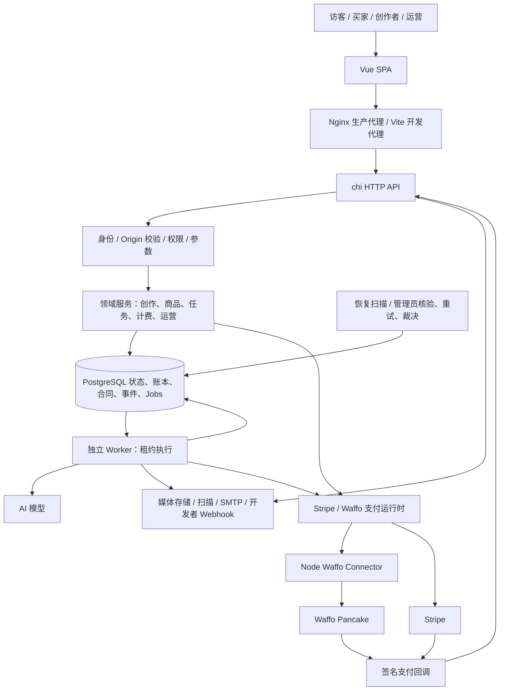
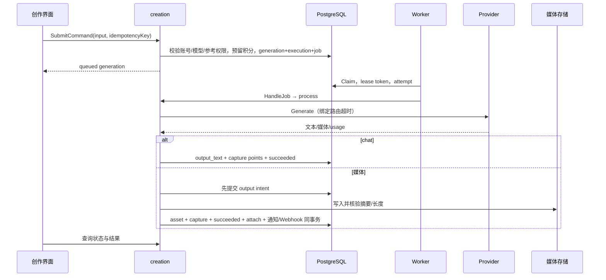
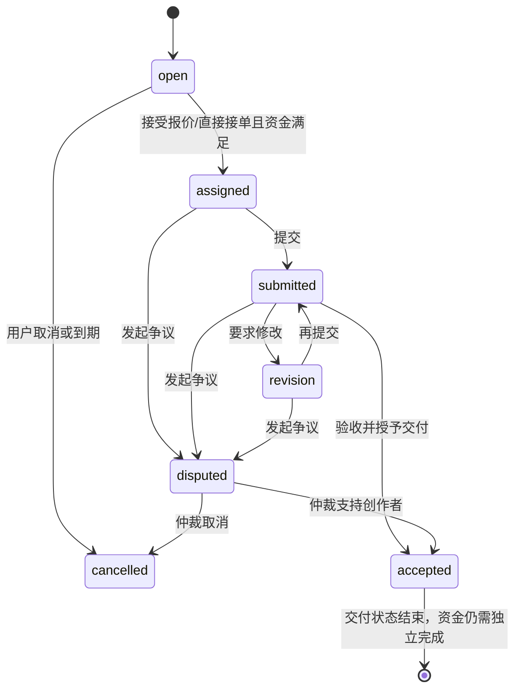

# HCAI-Chat 项目复盘与架构报告

复核日期：2026-10-04。范围：当前工作区，包括未提交的实现；不是仅针对 HEAD，也不是生产环境验收。

## 0. 阅读方法、证据边界与勘误

本报告结合入口装配、服务函数、SQL、Worker 注册、前端调用及迁移约束分析。核心资金、生成、任务、隐私与回调链路进行了函数级追踪；辅助模块进行了职责及关键实现核查。没有声称逐行证明全部代码正确。真实商户、银行到账、邮件收件、生产对象存储与灾备恢复需要外部证据。

附件 pasted-text-1.txt 已完整读取：要求第二阶段从业务闭环审计，并明确“不要直接修改代码”。因此本轮只更新报告，源码保留现状。业务问题、复现条件和修改建议详见 [业务闭环审计报告](business-closure-audit-20261004.md)。

本次复核纠正先前简报：

- 商品付款、权益、资产、订单完成、结算创建在同一个数据库事务内，不能描述为每一步都由独立 Job 执行、必然存在跨表断点。数据库外的付款和媒体写入仍有独立故障边界。
- 商品支付、退款、结算、卖家资金、生成执行、扫描、媒体写入已有专项恢复扫描。存在恢复机制不等于所有业务都能自动收敛。
- sellerfunds 是只读资金投影；实际资金命令在 payments 中。
- HTTP 任务链路显式使用 NewServiceWithPayments(pool, true)，不回退到旧本地账本结算。
- 当前 Makefile 已把 Go 门禁限定为 ./cmd/... ./internal/...；不能再称官方门禁必然被 data/ 快照阻塞。直接运行 go test ./... 仍与这一范围不同。
- 当前 diff 能确认 authchallenges、emailactions、identity 三处改动；datarights.Cancel 仍忽略取消 Job 的 Exec 错误，不能列为已修复。该 SQL 失败通常使整个 PostgreSQL 事务中止，随后写入/提交会报错；此前“必然提交成功而后台继续”的表述也不成立。
- 任务状态图中的 accepted 是交付验收完成，不等于外部收款人银行到账；不同业务的 completed 必须解释清楚。

## 1. 项目整体概览

这是一个 AI 创作、内容社区、数字资源交易及创作委托平台。普通用户可注册、购买订阅或充值、发起聊天/图片/视频/音乐生成、上传和管理资产、发布作品、购买数字商品、委托任务。创作者可报价、交付和收款；运营人员处理内容治理、模型路由、财务恢复、争议、隐私请求和客服。

核心业务不是单一聊天：它把“创作内容”转换为“可管理资产”，再转换为“可展示作品、可购买商品或委托交付物”。身份、授权、计费与可追溯的交易证据贯穿全流程。

现实目标包括：统一多种模型能力；以订阅和积分限制消耗；保护私有与付费媒体；让买卖双方通过合同快照、支付凭证、交付与售后协作；提供人工运营和故障恢复入口。

## 2. 项目全局地图

这是模块化单体的双进程部署，加一个可选支付适配服务。API 与 Worker 导入相同领域包、共享 PostgreSQL，不是每个 internal 子目录一个微服务。没有发现核心链路依赖 Redis、Kafka 或 RabbitMQ；队列就是 jobs 表。Pinia 状态、社区 feed 快照和 Provider 配置不是独立分布式缓存系统。

数据从浏览器命令、文件上传、Provider 回调、Worker 执行结果和管理员操作进入。数据库保存业务事实和证据，媒体存储保存字节；结果通过查询接口、授权下载、站内通知或签名 Webhook 输出。

## 3. 技术栈、目录与入口

| 层 | 实际实现 | 重要位置及关系 |
|---|---|---|
| 浏览器 | Vue 3、TypeScript、Vite、Pinia、Vue Router、vue-i18n | web/src/main.ts 挂载应用；App.vue 装配界面；router/index.ts 懒加载页面 |
| API 契约 | OpenAPI + openapi-typescript | internal/transport/httpapi/openapi.yaml → web/src/api/schema.d.ts；client.ts 封装 fetch |
| 服务 | Go 1.26.8（go.mod）、chi v5、pgx v5 | cmd/api/main.go → httpapi.New → 领域服务 |
| 异步 | 自建 PostgreSQL durable jobs | cmd/worker/main.go → jobs.Worker → 已注册 Handler |
| 数据库 | PostgreSQL，JSONB、行锁、advisory lock、视图、约束与触发器 | internal/platform/database；当前迁移文件序号至 0182 |
| 媒体 | local_file / AWS SDK v2 S3、完整性校验、临时文件预算 | internal/platform/media |
| 外部适配 | OpenAI 兼容接口、视频/音乐 Provider、Stripe、SMTP、Scanner | creation/provider_*、payments、platform/mailer 等 |
| Waffo 适配 | Node.js、@waffo/pancake-ts 0.19.1 | services/waffo-connector，持有商户私钥 |
| 验证 | Go test/vet、Vitest、ESLint、vue-tsc、Playwright | internal/**/*_test.go、web/e2e、.github/workflows/ci.yml |
| 部署 | Docker、多阶段镜像、Nginx、Compose | deploy/Dockerfile.*、compose.production.yml、nginx.conf |

目录作用：

- cmd/api、cmd/worker、cmd/migrate 是运行入口；cmd/seed 与 internal/testfixtures 是初始化/测试工具，不应当作线上业务自动发生。
- cmd/configcheck、providercheck、creativeprovidercheck、stripecheck、mailcheck、mediacheck、mediaappcheck、facilitycheck 是有专门运行条件的验证工具；openaifixture、stripefixture 是模拟服务；mediainventory 输出存储盘点。
- internal/transport/httpapi 负责传输层；internal 中各领域包负责 SQL、校验、事务和业务行为；没有强制统一 Repository 接口，Service 直接执行 SQL 很常见。
- web/src/pages 面向路由场景；components 分为通用 UI、领域界面和创作组件；stores 保存会话/草稿/偏好/通知；lib 处理命令幂等、媒体展示、资产授权等共享逻辑。
- scripts 包括开发启动、集成验收、备份恢复、支付/生成演练与发布检查。
- docs 保存 ADR、业务复盘和实施/验收记录；data 包括本地数据和历史快照，不能直接当成生产包或清理对象。

启动过程：读取配置 → 创建并 Ping pgxpool → 迁移 → 组装运行时与领域对象 → API 监听或 Worker 启动。迁移通过全局 advisory lock 串行化，每个 up.sql 独立事务并记录 schema_migrations；down.sql 不由启动过程自动执行。

API 超时为 ReadHeader 5s、Read 15s、Write 30s、Idle 60s，退出时给 Shutdown 10s。媒体端点与反向代理的实际流式超时需结合对应 handler 的专用设置，不能只看 Nginx 超时就认定应用同样允许长请求。

## 4. 前端模块：用户操作如何变成命令

router/index.ts 映射首页、发现、搜索、创作、作品、社区、商品、任务、工作区、账户、客服和管理员页面。路由切换不是后端授权，服务端仍需验证身份和资源归属。

api/client.ts 的 request 用 credentials: include 调用 /api/v1，解析统一 ErrorEnvelope，并把 status、code、retryable、requestId 包装为 APIError。非认证写操作先 assertCommandSessionReady，阻止账号切换期间把旧页面命令发给新 Cookie。

stores/session.ts 通过 revision 与在途 mutation 管理认证切换，结合 lib/taskCommands 限制写操作。taskCommands 为若干任务/财务命令复用请求键、处理账号上下文；不能推断所有命令自动享有这层保证。生成 createGeneration 每次生成随机键，存在已确认的恢复缺口。

components/create/MultimodalCreationStudio.vue 负责会话、输入、模型与多模态参数、参考资产上传/扫描等待、批量创建以及结果轮询；pages/CreatePage.vue 是场景容器。WorkspacePage 汇总资产、生成记录、订单与任务等个人视图。SellerProducts、SellerSales、SellerPayouts 和专门的管理员页面共享领域组件及 API 类型。

preferences、creationDraft、siteConfig、notifications stores 分别承载界面偏好、创作草稿、站点配置、通知上下文。它们不是后端事实源；订单成功、积分余额与资产授权不能依靠本地状态确认。i18n/messages 提供领域错误及中英文文案，渲染 Markdown 使用 marked/DOMPurify。

## 5. 服务端模块逐项复盘

下表中路径相对于仓库根目录；核心函数和后续调用链可直接用于定位。每行给出模块目的、输入输出及协作边界。

| 模块 | 为什么存在、核心代码/状态 | 输入 → 处理 → 输出；调用关系 |
|---|---|---|
| transport/httpapi | server.go 装配路由；identity、payments、tasks、vertical、data_rights 等 handler 分配领域命令；openapi.yaml 描述契约 | HTTP/Cookie/JSON/multipart/签名原文 → 参数与授权 → Service → JSON/ErrorEnvelope/媒体流；统一 Origin 校验对两个支付回调作精确豁免 |
| identity | repository.go 管理账户、密码认证、Session、角色权限及身份配置；用户状态与会话过期影响所有私有操作 | 认证信息/token → 数据库查询、密码验证、会话创建/撤销 → User 和 token；由 auth handler/middleware 及验证码服务调用 |
| authchallenges | service.go 的 ConfirmLogin、CompleteRegistration 处理先验邮箱验证码，限制验证次数及有效期 | 邮箱、purpose、challengeId、code → 密文投递、hash 比对、消费事务 → 登录/注册；投递与过期由 Worker 处理 |
| emailactions | service.go 的 consume 处理验证邮箱/重置密码链接，另有投递、重试、撤销与过期 | token → 验证种类/状态/过期 → 修改身份、销毁 token → 用户结果；SMTP 与开发 mailbox 是不同交付方式 |
| billing | points.go 的 Reserve/Capture/ReleaseGenerationPointsTx、订阅与定价；service.go 管理钱包账目；subscription_*、topup_settings 管理套餐契约 | 模型价格、订阅、生成用量、已验真支付 → 锁余额/预留/扣减/释放 → 钱包或积分流水；creation、payments、admin 调用 |
| creation | service.go 管理 SubmitCommand/Cancel/Retry/process；conversations.go 管理聊天归属；capabilities 与 reference_permissions 校验能力、来源、授权 | prompt、mode、参数、参考资产、命令键 → 计费预留+generation+Job → Provider → 文本或资产；依赖 billing/media/output journal/通知 |
| generationoutput | journal.go + cleanup.go 把生成输出外部写入变成可追踪意图 | owner/generation/asset 与字节摘要 → 先持久化 intent，写入并校验，再 AttachTx → 可归属对象；Worker 对孤儿意图恢复清理 |
| assets | service.go 统一上传、列表、使用关系、读取；upload_command/commit 幂等；scan_execution/recovery 绑定扫描执行；purchase_access 提供购买授权投影 | multipart、owner、资源访问请求 → 限额/MIME/归属/扫描/权益校验 → Asset 或授权内容；creation/社区/商品/任务共用 |
| uploadwrite | journal.go + cleanup.go 防止上传写成功但事务失败后丢失对象归属 | owner、asset、bytes → RegisterTx 提交 → WriteTx 验证 → AttachTx → 持久化资产；未挂接写入由 Reconcile 接管 |
| mediainventory | report.go 做存储对象与数据库引用盘点 | 数据库一致性读取+存储 Inventory → 批量 referenceBatch → 报告；由命令工具调用，不能把盘点当作自动授权删除 |
| discovery | repository.go 的 List/Get/SearchWithPolicy/Creator；filters.go 绑定游标和过滤范围 | 可见作品/商品/创作者/任务+query → SQL 排序、权重策略、分页 → 公共目录；运营 ranking/evaluation 控制策略 |
| community | repository.go 发布作品和帖子、草稿；post_lifecycle、interactions、feed 管理编辑删除、评论反应、关注举报申诉、快照分页 | clean 自有资产/正文/版本 → 发布事务，生成 work/post/Webhook；举报 → risk → admin 裁决；购买物/任务授予物有发布限制 |
| marketplace | catalog/publication 管理商品、版本和上架；service.go 查询订单及事件；sales/preview 管理卖家视图和预览 | 卖家资产/许可/价格及审核 → 可售商品；买家查询 → 支付入口；实际远端扣款与履约在 payments |
| productpolicy | refund.go 保存退款理由及窗口计算 | 订单时间/天数/当前时间 → RefundWindowOpen 等规则 → 退款资格；避免各入口自行解释日期 |
| payments | service.go 验证和落地 Provider 事件；workflow.go 跨充值、订阅、商品、任务；product_* 和 seller_* 专项实现恢复、争议、结算、提现 | checkout/签名事件/管理员命令/Job → 不可变请求与身份、账务和状态事务 → 订单/权益/退款/资金证据；依赖远端 Provider 与下游交付 |
| productdelivery | snapshot.go ReserveTx/Ensure/Load；bundle.go ZIP 与 Manifest；source_safety；repair/upload/inventory 支持修复 | 冻结订单合同中的原件 → 独立且可校验的交付快照 → 买家下载；管理员按版本、摘要和证据修复，不能任意替换商品 |
| sellerfunds | projection.go 的 AccountsQuery 是共享只读 SQL，区分 provider/live_mode/currency/account | 结算、账本、预留、追偿 → available/reserved/recovery/withdrawable；payments 和隐私导出读取；不执行转账 |
| tasks | service.go Create/Propose/Claim/AcceptProposal/Deliver/Review/OpenDispute/Cancel；deadlines.go 延期与开放任务到期 | 委托合同、报价、付款、交付 → demands/proposals/deliveries/settlements → 验收或争议；付款/退回/转账委托 payments |
| taskdelivery | grants.go 的 GrantTx 与验收或仲裁共用 | 已接受 delivery、clean 创作者资产 → 资产副本和 task_delivery_grants 合同证据 → 委托人授权下载；默认不授予衍生复用/转售 |
| tasktypes | 分类与 delivery kind 的受控配置 | 管理员分类命令 → 分类状态/顺序/交付类型 → 任务/社区/商品表单；已经形成的交付合同不能由分类改名偷偷改变 |
| datarights | service.go 请求/取消/删除；export、cleanup、recovery、hold_expiry 等文件实现包导出、物理清理与人工恢复 | 身份再次确认 → request+Job → scheduled/blocked/processing 或 ready → 下载/删除回执；合同保留、legal hold 与交易依赖影响清理 |
| accountlifecycle | lock.go 统一账户生命周期 advisory lock | user UUID → 锁；creation、上传、数据删除等协同，防止注销后迟到结果重新写入私有数据 |
| developer | service.go 账户、API Key 签发轮换撤销、Authenticate、控制开关 | key/scopes/IP/TTL → hash 验证、用户状态与白名单 → Principal；提供有限已接入的 API 权限，不代表所有浏览器接口支持机器 token |
| webhooks | service.go 端点、密钥版本、事件、死信重放；delivery.go start/send/record | 领域 EnqueueTx → event/delivery/Job → 带 ID、时间戳与 HMAC 请求 → succeeded/retry_scheduled/dead_letter；外部接收方应按事件 ID 去重 |
| notifications | repository.go CreateTx、HandleDeliveryJob、List、偏好与已读 | 领域事务写 notification+Job → 按用户偏好 delivered/suppressed → 页面；这是站内交付，不是 SMTP 投递，更不是用户已阅读 |
| support | service.go 用户工单/回复/AdminReply/AdminUpdate，版本与负责人 | 用户问题及相关资源 ID → 工单、消息、事件 → 人工处理与回复；关闭客服工单并不执行退款或仲裁 |
| risk | record.go RecordTx + 规则版本快照 | 举报、争议、拒绝媒体、账号关联信号 → source_key 去重、等级计算 → 风险事件；供运营判断，不等于自动裁决资金 |
| admin | 按 finance、payment、task、governance、media、provider/model、risk、settings 分文件 | 带权限、expectedVersion、确认/原因的命令 → 域状态改变、审计及后续 Job；人工节点属于业务链，不是数据库外口头流程 |
| reconciliation | service.go Request/HandleJob/localEvidence/finish；openai_costs.go 远端成本聚合 | 指定时间范围、本地用量、Provider 成本 → 不可变差异报告/超额标记；不是全平台自动银行对账 |
| systemsettings | gates.go RequireTx 校验 registrations/generations/publishing/checkout/task_creation | 事务内读取单例开关 → 允许/拒绝新增能力；不是简单前端禁用按钮 |
| observability | repository/metrics/maintenance 记录请求和维护扫描，聚合 Job、媒体及资金积压 | handler/Worker 的最小化观察 → PostgreSQL+指标端点+日志；健康检查与业务未结数量应分开理解 |
| platform | config 校验；database 连接/迁移；jobs 租约；media 存储/扫描/预算；mailer；password；httputil；providers catalog | 为 API/Worker 提供底层实现；协议声明与数据库触发器共同拒绝旧版本 writer |
| testutil / testfixtures | postgres.go 创建模板和每个测试的独立数据库；fixtures 提供业务种子 | 测试数据库 URL → 隔离复制/清理 → 测试；数据库未配置且不可用时某些集成测试可以 Skip，CI 使用强制开关避免假绿 |

## 6. 核心调用链与数据变化

### 6.1 登录与账户生命周期

浏览器 → identity/auth challenge handler → Start/投递 Job → SMTP 或 mailbox → ConfirmLogin/CompleteRegistration → challenge 行锁、过期/次数/hash 校验 → consumeLogin 或 RegisterVerifiedTx → User+Session → Cookie。

验证码失败只增长验证计数；过期清空敏感 token 信息；会话撤销/账户禁用影响后续鉴权。邮件重置动作独立于验证码登录。OAuth 配置/账户表的存在不代表每家 OAuth Provider 都通过真实登录验收；需结合启用配置、路由和外部凭据确认。

### 6.2 AI 创作、计费、输出

SubmitCommand 对相同 actor/operation/key 的 payload hash 检查重放；重试是业务命令而不是简单刷新页面。ReserveGenerationPointsTx 要求有效订阅和模型资格，并锁 point_accounts，保证 balance-reserved 足够。Capture 检查释放本次预留后可用余额，不侵犯其他生成的预留；已 captured 返回原结果。Release 关闭预留。

process 在外调前后、写媒体前后检查账号、引用授权、执行绑定与租约，避免取消/删号后的迟到提交。失败可重试时 generation 回 queued；终止失败通过 failGenerationTx 释放积分和旧预留，再发失败证据 Job。ReconcileExecutions 依据绑定 Job 和实际 attempt 终态恢复，不能仅凭更新时间推断失败。

聊天响应存 output_text，不创建可发布媒体资产。媒体输出采用确定性 assetID 和单独写入日志。这个 journal 解决媒体对象归属，不保证远端模型请求只执行一次；详见审计 B08。

### 6.3 上传、扫描、发布与引用

上传 handler → assets 上传命令验证（归属、类型、大小、幂等）→ uploadwrite.RegisterTx 先提交 → WriteTx 写入并 OpenVerified → 资产、扫描 Job、AttachTx 同事务 → Scanner → clean/拒绝或失败 → 用户可在适用权限下使用。

发布 → community.Publish 或 PublishDraft → clean、自有且非禁止再发布来源检查 → works+posts+Webhook 原子提交 → discovery/社区可见。商品上架走 marketplace 独立的合同和审核流程；“发布作品”不会自动成为“售卖商品”。

授权读取资产必须结合 source_type：自有、purchase、delivery 的可读与可复用规则不同；UI 是否显示卡片不等于下载许可。购买退款会撤销权益；历史已经下载到用户设备的字节无法通过数据库状态撤回。

### 6.4 商品购买与退款

BeginProductCheckout → 锁买家/商品作用域 → 校验 offerVersion、许可接受、售卖条件 → 保存 order、payment intent、不可变合同与原始 Provider 身份/请求 → 准备 productdelivery 快照 → 记录 dispatch → 调用 Provider → 保存 checkout。

签名回调 → ReceiveStripeWebhook/ReceiveWaffoWebhook → 验证并最小化事件 → 接收证据及 payment event Job → HandlePaymentEventJob → fulfillProductPaymentTx → 金额、币种、付款标识、用户状态、来源安全、快照完整性校验 → 同事务创建 purchase Asset、entitlement、fulfilled Order、paid Intent、settlement、通知和 Webhook。

已关闭支付的迟到成功、账号不可用、合同或源件失效、已经拥有等情形会转补偿退款，而不是无条件发货。数据库事务内失败回滚，不会留下半个 entitlement；真实远端付款已发生时，则依靠回调处理重试、只读核验与补偿继续。

BeginProductRefund → order refund_requested/intent refund_pending → Provider refund → 验真确认 → refundProductPaymentTx 撤销 entitlements、更新订单和付款、写清理 Job、调整 settlement、发通知。退款请求成功不等于退款完成。原件清理考虑订单证据、保留与 legal hold。

### 6.5 卖家资金：三个不同的完成点

订单履约 → ensureProductSettlementTx → 冻结期/资格/账户域 → seller funds 记账 → 卖家提现申请 → 运营审核与资金入账准备 → connected account/银行 payout → Provider 只读检查 → 确认 paid/failed/returned 或待对账。

“买家已付款”“平台已分配卖家资金”“卖家银行已到账”是不同事实。payments 下 seller_payout_funding、seller_bank_payout、seller_source_reversal 及 closure/disposition 系列保存请求、执行、核验和后续退回/追偿。sellerfunds 投影遇到未知归属或追偿余额时把 withdrawable 压到零，防止把未经确认的钱再次提现。

外部真实到账仍需商户和银行端证据，不能拿账本余额当到账证明。

### 6.6 委托任务

Create → open → Propose 或直接接单 → BeginTaskCheckout 并经已验证支付建立资金 → Claim/AcceptProposal 校验付款、收款人、金额 → assigned → Deliver（合同类型/资产/版本）→ submitted → Review。

验收事务更新 delivery/demand 为 accepted，创建 provider_pending settlement，把付款置 transfer_pending，写转账 Job，GrantTx 创建委托人权益。Worker 转账后写 transferred/provider_transferred。验收完成不等于收款完成。

deadlines.HandleExpiryJob 只自动取消未指派 open 任务；已接单、待验收、争议不能仅凭时钟自动付款。延期由一方提议、另一方接受，不可单方更改生产期限。人工争议入口是 admin.ResolveTaskDispute；不只是客服留言。

### 6.7 数据导出与删除

Create 要求再次确认身份 → export queued 或删除 scheduled/blocked → Worker 导出包或执行删除 → request/events/receipt 记录结果。删除宽限期可取消；法律保留通过账户级锁与删除/媒体写入互斥。到期 hold 由独立扫描解除并重新安排。

删除先去标识与停止账户业务，再做媒体物理清理，最后生成回执。回执明确 productionBackupExpiry=externally_blocked；completed 表示本地主存储闭环，不证明生产备份、支付平台或用户已下载副本被删除。导出下载通过 OpenExport 流式接口，内部 Download 的整体 bytes API 不是 HTTP 大包路径。

## 7. 数据模型、唯一性与关联

| 数据簇 | 主要关联键/状态 | 产生与终结、读写方 |
|---|---|---|
| 用户与认证 | users.id；sessions；challenge/action ID；status、expires_at、version | identity 创建；认证服务消费；删号/撤销结束权限 |
| 创作 | conversations、generations、generation_commands、generation_executions、generation_reference_assets | owner/conversation/parentGeneration/command key/execution.job_id；queued→running→succeeded/failed/cancelled |
| 钱包/积分 | billing_accounts/entries/reservations；point_accounts/reservations；user_subscriptions | 金额 cents 与 points 分开；operation/generation 唯一关联；held→captured/released |
| 媒体 | assets、asset versions、upload_writes、generation_output_writes | owner、source_type/source_id、origin_asset_id、backend/key/digest/size；pending→attached 或清理 |
| 内容 | works、posts、comments、drafts、reports/appeals | author/asset/work/post；可见状态与草稿版本；治理可隐藏/处理 |
| 商品合同 | products、orders、product_order_contracts、product_delivery_snapshots | buyer/product/order、offerVersion、许可和价格快照；后续商品编辑不改已接受合同 |
| 付款与退款 | payment_intents、payment_provider_events/processing、payment_intent_events、refund attempts | provider+event、payment/order/resource、original identity、operation ID、version；请求/验真/处理分开 |
| 权益 | entitlements、购买 Asset、task_delivery_grants | user/product/order/asset 或 task/delivery/source；active/refunded、许可快照 |
| 任务 | demands、proposals、deliveries、delivery_assets、task_commands、task_disputes、task_settlements | client/assignee、demand、delivery version、settlement；任务业务状态与付款状态分离 |
| 卖家资金 | product_settlements、seller payout/ledger/recovery 及执行命令 | seller+provider+live_mode+currency+account；每层业务 ID 不等于银行交易 ID |
| 异步与证据 | jobs、job_attempts、audit_events、notifications、Webhook events/deliveries | business ID→Job ID→lease token/attempt；业务终态不能由 Job.status 单独推断 |
| 隐私与人工 | data_rights_requests/holds/receipts；support_cases/messages/events；risk_signals/events | user 或去标识 subject_ref；关联资源类型+UUID；操作者/version/原因追踪 |

UUID 负责实体身份，requestId 负责一次请求诊断，idempotency key 负责逻辑命令去重，Provider ID 负责远端事实关联；它们不能互换。JSONB 的灵活 payload/证据需靠版本、白名单和约束维持契约。

订单事件的 max(sequence)+1 必须连同同一订单行锁检查。已核查关闭、退款、恢复路径有订单锁，不能只搜到该表达式就宣布存在竞争。新增 writer 仍必须遵守相同锁规则。初次履约固定插入序号 2/3，也要求订单初始事件契约不变。

## 8. Worker、异常、并发与一致性

Worker 默认 4 个并发槽、750ms 轮询，每轮最多 claim 一个 Job；30s lease、每 lease/3 续租。Claim 使用 FOR UPDATE SKIP LOCKED，持久化 job_attempts；Complete/Fail 重新确认 owner/token 和有效时间。重试默认 attempts² 秒，可由 RetryDelay 覆盖；达到 MaxAttempts 或不可重试则 failed。

实际特点：

- 恢复过期租约不占 handler 槽；即使执行槽饱和也能释放死亡 Worker 的任务。
- cmd/worker 注册多种专项维护，每种独立 goroutine、启动首轮、每分钟扫描、通常每轮 10s/100 条；不是全部维护都被媒体任务直接阻塞。
- 执行槽仍被各业务共享；四个慢生成可推迟验证码、回调处理与通知，且轻任务领取速率上限约每进程 1.33 次/秒。应测队列等待分位数再隔离关键业务。
- PostgreSQL 事务只保证数据库内原子性；SMTP、对象写入、模型生成、支付远端动作无法随 SQL 回滚。
- Write-ahead journal、原始请求/商户快照、幂等业务 ID、Provider 只读核验及人工恢复是跨系统收敛手段。
- 不能用“所有 Job 都会重试”证明闭环：最终 attempt 进程死亡时，领域状态未必一起进入可人工处理状态，Webhook/通知尤其需要复核。
- pool 每进程 MaxConns=12；主 Worker 的 4 个 handler 加多种独立维护和事务内外部 I/O 会竞争连接。媒体预算限制内存/临时盘，但不能消除锁持有时间。
- 数据库 SQL 错误令事务中止，忽略单个错误会损害可诊断性，但不等于 PostgreSQL 会提交部分修改。

## 9. 外部依赖和配置机制

配置由 platform/config.Load 读取进程环境，不自动加载 .env.local；scripts/dev.sh 才 source 它。配置加载会严格解析布尔、数值和生产限制；配置错误启动失败。数据库里的 Provider 配置/模型路由/系统开关与环境注入的秘密分工，需要一致，否则支付或生成可以被拒绝。

| 分组 | 代表变量/要求 | 影响 |
|---|---|---|
| 基础 | APP_ENV、DATABASE_URL、HTTP_ADDR、WEB_ORIGIN、COOKIE_SECURE、TRUSTED_PROXY_CIDRS | 数据库、Cookie 与 Origin/代理信任边界 |
| 媒体 | MEDIA_ROOT、MEDIA_STORAGE_ADAPTER、MEDIA_S3_*、MEDIA_SCANNER_* | API/Worker 必须读取同一批对象；生产配置按 configcheck 验证 |
| 临时空间 | DATA_EXPORT_*、MEDIA_STAGE_* | 导出与校验的文件/字节/并发预算；Compose 的 tmpfs 大小需同步 |
| 邮件/加密 | EMAIL_DELIVERY_MODE、EMAIL_ACTION_ENCRYPTION_KEY_B64、SMTP_*、WEBHOOK_ENCRYPTION_KEY_B64 | 链接与Webhook密钥版本、SMTP发送；不能换 key 后假设旧密文仍可读 |
| 模型 | OPENAI_*、VIDEO_*、MUSIC_* 及 *_PAID_CALLS_APPROVED | 选择运行时、模型、超时、付费调用闸门 |
| Stripe | STRIPE_ENABLED、STRIPE_SECRET_KEY、STRIPE_WEBHOOK_SECRET、STRIPE_LIVE_MODE、STRIPE_LIVE_MODE_APPROVED | test/live、签名验证、远端操作与原始身份绑定 |
| Waffo | PAYMENT_PROVIDER、WAFFO_ENABLED、WAFFO_ENVIRONMENT、WAFFO_MERCHANT_ID/STORE_ID、WAFFO_CONNECTOR_URL/TOKEN | Go 通过内部 Connector 调 SDK；私钥只进入 Connector |
| 测试 | TEST_DATABASE_URL、HCAI_REQUIRE_INTEGRATION_TESTS | 集成测试需要可创建测试数据库的独立角色，禁止把生产库当测试库 |

Connector 采用 Bearer token，内部端点包括 /checkout/identity、/checkout、/checkout/lookup、/refund、/webhook/verify；请求体最多 1 MiB，错误输出最小化；Node 端通过 transport 传播请求取消。它不是前端可直接持有私钥调用的公共支付 API。Waffo 不具有与 Stripe 完全相同的转账和账户能力，TaskProviderStatus/能力校验会限制业务。

## 10. 从零运行与部署

1. 安装 go.mod 指定的 Go 工具链、兼容 Vite 的 Node（CI 使用 22）、npm、Docker/Compose。数据库采用 PostgreSQL 17。
2. 根据 .env.example 创建本地配置；只在私密环境注入凭据。为本地媒体提供目录；API 和 Worker 使用一致数据库、加密 key、存储配置。
3. 安装依赖：go mod download；npm --prefix web ci；需要 Connector 时 npm --prefix services/waffo-connector ci。
4. make db-up；在正确环境下 make migrate。空库是否需要种子取决于演示/验收场景，先阅读 cmd/seed 和 fixtures 的语义，不能混用生产身份与测试身份。
5. make dev 同时启动本地依赖、API、Worker、前端；或自行导出环境后分开 make api / make worker / make web。单独 make api 不会自动 source .env.local。
6. make build 构建 Go 二进制与前端；make lint 使用限定包范围。make test 或 make test-integration 会强制集成依赖，GO_TEST_TIMEOUT 默认 60m。
7. 生产先执行 make production-config-check，准备外置数据库、S3/扫描、SMTP、支付/模型配置和 TLS 入口。deploy/compose.production.yml 运行 migrate→api/worker→web；web 反代 /api、处理 SPA fallback；容器只读、去 capabilities、独立 tmpfs。
8. 依据 deploy 中发布门禁、备份恢复、facility acceptance 文档执行环境验收。备份成功不等于恢复成功；外部资金及删除回执需另核对。

CI 包含 runtime 多架构镜像检查、生产代理测试、依赖安全、Go/Node/Web 单元与集成、浏览器支付流程。查看配置存在不等于该流水线本次已执行。

## 11. 关键设计、重复、结构及性能

核心设计及已见收益：

- 领域状态、业务事件与 Job 在一事务写入，减少“记录完成但消息没有入队”的窗口。
- 不可变合同、Provider 身份和请求快照，防止后台改价格/套餐/商户后重放到另一个现实交易。
- execution binding + lease token + 数据库协议触发器防旧 Worker 提交，generation/output journal 把对象存储纳入恢复范围。
- 账户生命周期锁把删除、上传和生成结果提交串联，避免删除后复活数据。
- 资金按 Provider/环境/币种/账户分域；未知证据阻止支出，安全优先于猜测完成。
- 管理操作带 expectedVersion、权限、证据/原因，实现可审计的人工干预。

技术债务与证据：

| 项 | 现状与影响 | 建议 |
|---|---|---|
| 巨型业务文件 | workflow.go 当前 2834 行；creation/service.go 1746 行；支付 purpose 和异常分支集中 | 按 task/product/billing、接收/执行/恢复拆包内文件，保留事务所有权；不要先做全平台万能状态机 |
| 实质重复 | uploadwrite/journal.go 与 generationoutput/journal.go 的 Intent、WriteTx、AttachTx 高度相似 | 共享字节校验/存储写入原语，保留领域锁、表结构和协议差异 |
| 重复辅助函数 | 多包 cursor 编解码、oneOf、错误转译、审计与通知包装 | 提取稳定格式，避免抹平资源权限/金融命令语义 |
| DB 业务复杂度 | 迁移中的视图、约束、触发器与 Go 共担状态正确性 | 每个状态列维护 writer/read projection/恢复 owner 索引；新迁移验证旧 writer 拒绝 |
| 长事务 | generationoutput.WriteTx、任务转账持锁外调 | 测 lock wait/连接池饱和；若拆事务，必须新增 fencing、执行证据与结果恢复，不能单纯挪出 Commit |
| Worker 调度 | 四槽共用且每 tick 一个 claim | 分优先级或按业务隔离，保留统一租约协议；按积压与延迟验证 |
| 搜索 | SearchWithPolicy 用 offset，空超界页回查首页计算 total；0182 已增加 trigram 索引 | 用 EXPLAIN ANALYZE 核验深页与排名，不能在未测量时定性全表慢查询 |
| 导出/大媒体 | 已有流式导出、stage budget、验证摘要、ZIP Manifest | 评估并发峰值与 tmpfs 实际 RAM；不要误判所有文件都整包加载到 HTTP 内存 |
| 边界不一致 | 商品恢复非常细，任务/通知/Webhook 收敛较弱 | 优先补审计表中的业务出口，而非只做文件拆分 |

历史兼容分支：local_test Provider、旧 billing reservation、legacy market refund、任务本地账本，以及旧数据缺少身份/快照的保守拒绝。是否能删除需先确认生产历史数据，不能因为当前新路径不用就移除。

## 12. 本轮验证与修复记录

当前源码 diff 已确认：

- authchallenges 的过期更新与验证失败计数更新，显式传播 UPDATE/COMMIT 错误。
- emailactions 过期动作在 UPDATE/COMMIT 成功后才删除 mailbox；原顺序虽然先尝试 Commit，但会忽略失败继续删文件。
- identity 会话活动时间写失败显式返回错误。它同时意味着一次认证读成功后，活动写失败仍会使请求失败，是可用性取舍，需产品和运维了解。
- datarights.Cancel 的忽略错误仍在，未把它当成本轮已完成修复。

复核实际运行记录见业务审计最后一节。测试通过仅说明对应命令执行范围；此前 payments 整包 90s 超时不能证明死锁，Makefile 已明确该包预算很长。没有部署、真实扣款、发信、删除业务数据或创建 commit。

## 13. 最终项目认知与接手顺序

1. 项目是多模态 AI 创作与数字内容交易平台，核心并非单独聊天框。
2. 核心业务是创作消耗计费、资产授权、商品交易和任务交付。
3. 核心模块为 creation/billing/assets/payments/marketplace/tasks；productdelivery、taskdelivery 是授权与实际交付的关键边界。
4. 模块通过 Go 调用、同库事务、durable jobs 和证据表协作；Connector 是额外进程边界。
5. 最重要的数据是可归属的资产、被接受的合同、资金账本和原始远端证据，而不只是 UI 状态。
6. 主数据流是输入→命令与预留→外部执行→验证与原子提交→授权输出→售后/清理。
7. 最重要流程是生成、已验证付款履约、退款撤权、任务验收后转账。
8. 关键入口为 main.ts、httpapi.New、cmd/api/main.go、cmd/worker/main.go 及两个签名支付回调。
9. 核心执行链为 handler→service→事务/Job→Worker/Provider→状态与证据→查询/下载。
10. 单体内部有严肃的资金、对象存储和生命周期协议；需要同时读 Go 和迁移。
11. 辅助能力包括 discovery/community、通知、support、risk、observability、CLI 验收；辅助失败有时会阻塞主流程，因此不能忽略。
12. 关键设计是本地事务加远端证据恢复、冻结合同、授权访问和租约隔离，而非依赖重试运气。
13. 明确问题集中在部分提交恢复、任务异常状态出口、通知分页/失败收敛、Webhook 撤销竞争与备份删除责任。
14. 接手建议：先读入口及迁移协议 → creation/points/execution → 商品 checkout/fulfill/refund → tasks 与 admin recovery → assets/datarights → 前端命令会话边界 → 部署验收。优先修复业务收敛，再进行结构重构。
