# HCAI-Chat 目标业务模型与业务流程设计

日期：2026-10-04。阶段：业务模型重建；交付物是业务规格，不是实现方案或上线认证。

依据：[现状复盘](project-review-20261004.md)、[闭环审计](business-closure-audit-20261004.md)，以及本阶段对现有退款政策、委托期限与交付授权、付款恢复、生成提交、通知查询、开发者授权和风险治理规则的复核。现状包含当前工作区未提交内容；没有修改业务源码。

## 1. 目标业务模型概览

### 1.1 产品及业务边界

目标是一个让用户获得 AI 创作服务、管理内容资产、交易数字内容许可、委托创作者交付，并能处理售后与隐私权利的平台。平台销售的不是一个孤立文件链接，而是具有来源、许可、交付标准、资金责任和售后条件的服务或数字内容权益。

业务分为六个领域：身份与资格；创作与资产；内容与商品供给；交易与资金；委托与交付；治理与服务保障。搜索是发现供给的入口，通知是事实传播渠道，后台执行是完成业务的手段，都不能代替合同、付款和交付事实。

文中使用三个严格区分的标签：

- **As-Is**：前两阶段及本阶段核查所得的当前行为；只在差异与依据部分作为事实描述。
- **To-Be**：本报告提出的目标规范。包含必须满足的一致性底线及建议采纳的业务流程，不表示已经实施或已经获得商业批准。
- **待业务确认 Qxx**：无法由代码确定的合同、金额、时限、法律或产品政策。相关分支完整保留，不填造数字；确认前不得把它作为已获批准的自动决策规则。

本报告可以作为设计评审与开发拆解依据；受 Qxx 影响的收费、自动裁决、数据留存等分支必须在对应规则批准后才能启用。设计完整不等于所有商业决策已经完成。

### 1.2 目标完成语义

| 完成维度 | 需要成立的事实 | 不足以证明完成的信号 |
|---|---|---|
| 服务结果 | 合同约定的文本或媒体结果完整、可访问、可归属 | 执行进程退出、第三方返回 accepted |
| 交付与权益 | 正确接收人获得符合约定的内容版本与许可 | 文件存在、卖家说已交付 |
| 付款 | 原支付账户域的金额、币种、对象与已确认付款一致 | 跳转成功页、用户截图、请求发送成功 |
| 退款 | 原退款责任对应的远端退回结果被核实 | refund ID 存在、客服关单 |
| 卖家收款 | 明确区分可结算、平台划拨完成、银行已确认到账 | 买家已付款、平台余额增加 |
| 通知 | 可见/送达/阅读分别记录，失败有人接管 | 领域业务成功、发送任务成功 |
| 隐私 | 每个删除范围有完成、合法保留或外部待办证据 | 本地账户消失、主库清理完成 |
| 业务结束 | 核心结果成立，所有必要后续责任已履行，或有正式且有依据的终结决定 | 仅一个对象 status=completed |

订单可以显示“已交付，结算处理中”，注销可以显示“主数据已清理，备份待到期”，但不得显示没有限定范围的“全部完成”。审计保留、售后窗口可以继续存在，属于明确的持续责任，不要求把正常订单永久显示为处理中。

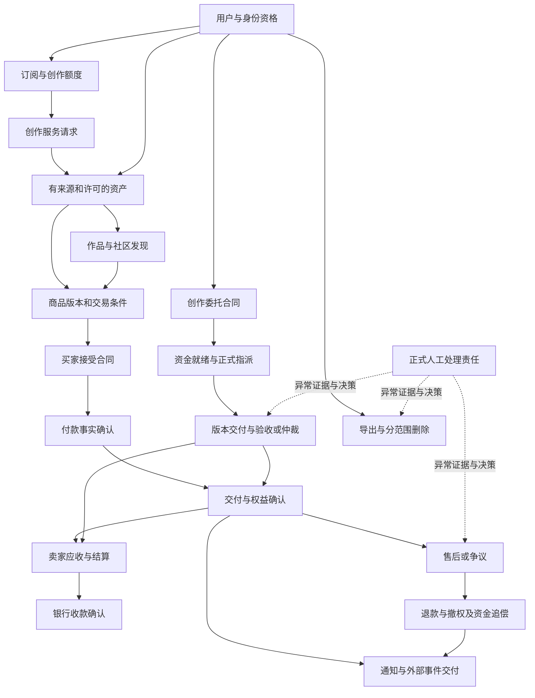

### 1.3 业务角色与责任

| 角色 | 可以作出的决定 | 不可越过的边界 | 异常责任 |
|---|---|---|---|
| 访客/普通用户 | 浏览公开信息、申请身份、管理自己的服务与数据 | 不可访问他人私有数据 | 提供所需身份与业务证据 |
| 买家/委托人 | 接受交易条款、支付、验收、提出售后 | 不可擅自改变已接受合同或占有超出许可的权利 | 响应交付及争议举证 |
| 卖家/受托创作者 | 提供合法供给、报价、交付、申请收款 | 不得用后续修改替换已承诺版本 | 内容来源、交付质量与履约举证 |
| 开发者/接收方 | 在被授予范围内调用和接收事件 | 机器凭证不能扩大所有者权限 | 密钥维护、接收事件去重 |
| 内容审核员 | 按版本化政策审核、限制、复核内容 | 内容风险信号不是资金裁决 | 审核理由、申诉与复核 |
| 客服 | 沟通、关联业务、分派和跟踪 | 工单状态不直接等于退款、到账或仲裁 | 用户沟通和转交不丢失 |
| 财务运营/争议裁决者 | 核验资金、按权限作裁决或核销申请 | 无证据不能声明钱未付/已退；不能改原始事实 | 未结资金与裁决的后续跟踪 |
| 业务规则负责人 | 批准价格、条款、时限、权限和政策版本 | 新规则不自动追溯旧合同 | 规则冲突与版本生效 |
| 隐私负责人/运维 | 处理保留、清理、备份和处理商证据 | 不以删号消除合法债务或凭空延长保留 | 各范围删除责任 |
| 模型/支付/扫描/存储/邮件供应商 | 按能力产生外部结果与凭证 | 回调只作证据输入，不能绕过本地业务校验 | 通过平台指定 owner 协调外部异常 |

以上是责任角色，不要求对应新增职位；具体人员和权限分离标准待 Q12。当前无独立“业务员佣金/代理销售”业务证据，不增设业务员对象或佣金链。

## 2. 核心业务对象

“拥有”区分数据控制权、内容著作权、使用许可和资金债权，不能混为用户 ID。下表状态为目标业务语言，并不指定数据库枚举。

| 对象 | 定义与存在目的；归属 | 创建/操作主体与关联 | 生命周期与结束条件 |
|---|---|---|---|
| 用户主体 | 人在平台的业务身份；本人控制个人资料 | 认证建立；本人维护；关联账户、合同、凭证与隐私请求；运营可依法限制 | 有效→受限/恢复→注销处理中→去标识；历史合同按合法范围保留 |
| 认证挑战与会话 | 证明身份及有限期授权，不是用户本身 | 用户申请；认证服务核实；关联主体、用途、设备上下文 | 待验证→已消费，或过期/撤销/次数耗尽；会话有效→过期/撤销 |
| 资金账户与积分账户 | 分别表示货币责任和服务计量额度；归属用户或卖家账户域 | 由确认的付款/结算/服务消耗改变；关联账目与预留 | 活跃→受限→关闭；余额/未决责任清结前不可视为全部结清 |
| 套餐/订阅权益 | 可购买的服务条款和用户在确定期间的资格 | 运营定义套餐版本；用户接受；付款确认授予 | 套餐草稿→生效→停售；订阅待生效→有效→到期/按约终止，历史条款不变 |
| 创作会话与生成批次 | 会话承载上下文；批次承载一次用户意图中的多个独立子请求 | 用户创建；关联父结果、参考资产和生成子项 | 会话可持续/归档；批次子项全部确定且账务处理完成才结束，允许部分成功 |
| 生成服务请求与执行尝试 | 请求定义交付；尝试记录一次执行事实 | 用户授权请求，平台执行，供应商产出；关联预留、结果、成本证据 | 待执行→执行/待核验→结果确认/失败/取消；尝试不等于新收费请求 |
| 服务结果 | 文本或媒体及其来源证据；用户依合同获得使用权 | 平台验证产生；关联生成、用量、参考资产、输出资产 | 待验证→可交付/拒绝；内容保留与删除独立于请求终态 |
| 资产及资产版本 | 可归属、可验证的内容记录，不直接等于售卖权 | 上传/生成/购买/验收产生；本人、授权人和保留管理者操作 | 接收→检验→可用/隔离→逻辑删除→按引用与保留规则物理清理 |
| 作品/帖子/互动 | 对内容的公开表达及社区关系，不改变内容原始权利 | 作者发布编辑；用户互动；审核员治理 | 草稿→公开/受限→撤回；互动生效/撤销，治理证据按政策保留 |
| 商品及供给版本 | 内容、价格、许可、退款与交付条款的可售组合 | 卖家提交，审核批准；买家接受一个确定版本 | 草稿→审核→可售→停售；修订产生新版本，旧订单保留原版 |
| 购买订单与合同 | 买卖双方对一个供给的承诺与执行记录 | 买家接受创建；关联付款、内容快照、权益、售后、结算 | 待付款→待交付→已交付；可转取消或售后；关闭不能抹去追偿 |
| 支付意图与资金操作 | 支付意图说明应收什么；操作说明向谁请求付款/退款/转账 | 原业务发起；支付方核实；关联商户域、金额、币种、远端身份 | 未发送→在途→已确认/确定失败，未知→核验或正式人工处置 |
| 交付包与权益授予 | 内容版本及接收人可执行的许可 | 购买履约或委托验收授予；关联合同、原件摘要与接收人 | 待确认→生效→受限/撤销/到期；已下载副本不可假称可收回 |
| 售后/退款/商品争议 | 处理不履约、退款请求及支付机构争议的独立责任 | 买家、运营或外部机构发起；关联订单及原资金操作 | 申请→审查/取证→决定→执行→核验→关闭；不同退款/拒付来源必须归并核对 |
| 卖家应收、结算、提现与追偿 | 分别表达收入归属、可支出资格、银行出款和应追回责任 | 履约产生应收，财务与卖家发起后续；按商户/环境/币种/账户隔离 | 待结算→可用/冻结→预留→出款确认；退回/退款引发追偿，不能删除原流水 |
| 委托、报价及协定 | 约定创作需求、价格、期限、交付种类及权利 | 委托人发布，创作者报价，双方确认；关联任务资金 | 待承接→资金及协议就绪→制作→交付→验收/取消/争议；延期是新的双方协定 |
| 委托交付版本与验收决定 | 记录提交过什么、验收了哪个版本 | 创作者提交，委托人或有权裁决者决定；关联资产与授权 | 已提交→要求修改/已接受/拒绝；已接受版本不可被后续上传覆盖 |
| 治理案件与风险信号 | 信号提供线索；案件承载调查、处置及申诉 | 用户举报/系统信号发起；审核人员处理 | 信号已记录→关联案件；案件待处理→审查→决定→执行→复核/关闭 |
| 人工处理任务 | 对未收敛责任正式分派的对象 | 业务异常或用户申诉创建；指定角色领取；关联原业务/证据/决定 | 待分派→已领取→取证→决定待核实→执行待确认→关闭；可升级/转交 |
| 客服工单 | 用户沟通与协调承诺，不是财务授权 | 用户/客服发起和回复；关联业务及人工任务 | 开启→处理/等待→已解决→关闭或有依据重开 |
| 通知与订阅事件 | 通知供人获知事实；事件供授权系统消费 | 领域事实产生；用户偏好/接收方决定渠道 | 待交付→可见/接收确认/抑制/失败待处理；阅读单独记录 |
| 服务身份、密钥、回调端点 | 用户授予机器或外部接收方的有限权限 | 所有者签发、轮换、撤销；关联范围、到期及密钥版本 | 有效→到期/撤销；轮换建立新授权，不恢复被撤销旧授权 |
| 隐私请求、保留决定与清理回执 | 用户权利及平台对各数据范围的责任 | 本人核实发起；隐私角色处理；关联数据范围、处理商与证据 | 待处理→执行/合法保留→分范围完成；回执保留必要追溯而非敏感全文 |
| 核对报告与差异案件 | 比较本地与外部事实，承接无法对应的责任 | 定时或授权人员发起；财务/运维核实 | 收集→报告→差异分派→修正核验/批准终结，报告生成不代表差异解决 |
| 业务政策、供应商能力与变更决定 | 明确谁可在何条件下经营及承担什么能力 | 业务负责人批准；关联合同/定价/范围/生效时间 | 提案→验证/审批→生效→撤回/被替代；运行中责任按原约定继续处理 |
| 外部供应商及合作账户 | 能提供模型、资金、扫描、存储或投递能力的合作主体；不是平台用户的资金账户 | 合作管理者建立；业务负责人批准能力；关联协议版本、商户/环境、操作证据和在途责任 | 待验证→准入→有效→限制新业务→退出；旧责任及必要查询不能因退出丢失 |
| 内容分类与服务能力定义 | 限定用户可选交付种类、模型能力及供给描述，避免承诺无法交付的服务 | 业务负责人创建/批准，卖家或委托人选择；被供给/委托合同按版本引用 | 草稿→生效→停售/被替代；名称变化不改变已接受交付类型 |

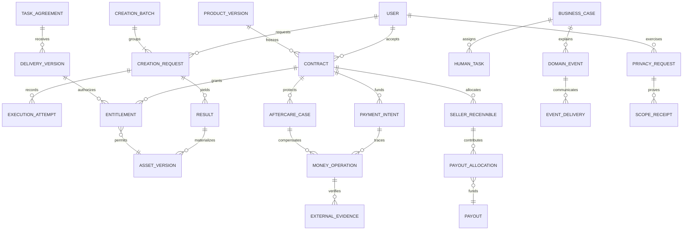

图为概念关系：CONTRACT 可源于商品订单或委托协定；BUSINESS_CASE 是追溯身份概念，不要求所有领域共用一个对象或一套状态。RESULT 包括文本，因此并非每个结果都必须生成资产。

## 3. 核心业务流程

下面定义 F01–F19。每项均包括目标、参与者、前置/输入、正常/异常/人工/数据流和结束标准。图中“人工任务”统一进入第 7 节的可审计处理流程；每项指定对应负责角色。状态含义及转换约束见第 4 节；所有非终态必须记录下一责任人与检查期限。

### F01 身份建立、登录及账户安全变更

**目标/参与者**：本人证明身份并取得适用权限；认证服务核实，安全运营处理争议。前置是开放对应身份业务、用途明确且未触发限制；输入为身份信息、验证证据、操作用途与原会话上下文。密码重置/邮箱变更属于高影响身份变更，不可用普通已登录状态替代所需证明。

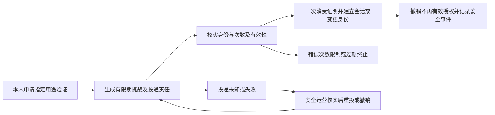

输出是可追溯的身份决定及会话/变更结果，后置是适用的安全告知与旧授权处置。取消或到期不能再次消费证明；重复同一确认只返回原结果，不重新签发无限会话。服务中断先核对是否已消费；邮件发送未知不延长验证码期限。结束由身份事实确认，不以收件箱送达代替；身份争议只能通过正式核实恢复。具体会话撤销范围与通知渠道待 Q01。

### F02 套餐购买、充值与订阅生命周期

**目标/参与者**：用户获得已付费且条款明确的服务资格/额度；平台确认资金，计费负责人处理差异。输入是套餐或额度、价格币种、适用期间和用户接受的版本；前置是账户有效、商品能力可兑现、付款方式支持，已有冲突订阅按规则处理（Q02）。货币余额、积分、订阅资格分别记录，不能相互推导。

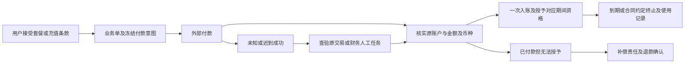

输出为账目、资格和可读凭证；后置为通知、到期提醒/关闭适用资格。未支付可取消，已支付取消必须进入适用售后而非删单；入账中断重放原凭证。付款成功与授予失败必须保留补偿责任。购买完成以资金和对应权益同时成立为准，订阅使用期结束另行确认。续费、升级、积分到期、消费后退款不从代码默认推出，列 Q02/Q03。

### F03 AI 创作、会话与批次生成

**目标/参与者**：用户在明确计价和能力下取得结果；平台执行、模型供应商产出，创作运营核实失败成本。输入为模式、上下文、参数、参考资产授权、定价版本及批次子项身份；前置为资格、额度与内容许可满足。

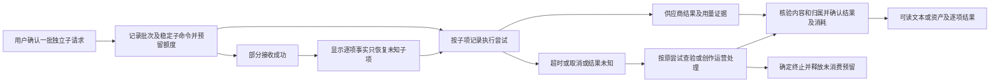

用户关闭页面不取消服务；“重新获取未确认结果”与“再创作一次”是不同意图。前者复用原业务身份，后者明确形成新收费请求。批次允许部分成功，不撤销已交付成果，也不重做整批。结果提交必须同时确定收费/释放规则；晚到结果与取消谁先形成有效决定由第 6 节仲裁，不能双重给出终态。供应商不能查询或去重时，平台不得宣称恰好执行一次；用户收费边界和平台成本承担待 Q04。人工可凭结果证据确认或按获批政策终止服务，但不能把远端未知成本标成零。批次终结要求每子项已确定且无有效预留遗留。

### F04 资产接收、检验、使用与清理

**目标/参与者**：维护真实可读且授权清楚的资产。用户或生成/购买/交付业务创建；内容安全与存储运营处理异常。输入为内容、来源、摘要/大小、所有者和许可；前置是类型、配额、账户及来源允许。

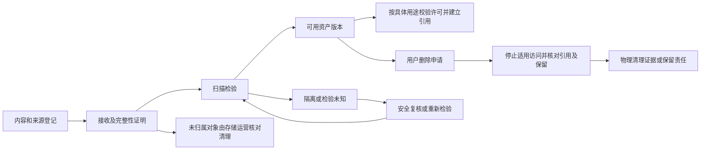

下载、引用生成、公开发布和再销售是不同用途；“我能看见”不等于“我有转售权”。扫描服务超时保持不可用，人工不得仅为解卡把未知改成 clean。删除不破坏已售合同或正在生效的交付；删除与业务写入竞争须形成一个获准顺序。后置为配额释放、引用更新、授权变更通知。接收完成以可用或明确拒绝为准；清理完成另有证据。保留期限及隔离申诉待 Q05/Q11。

### F05 作品发布、社区互动与发现

**目标/参与者**：用户在授权与社区规则下展示和发现内容；作者编辑、访问者互动、内容运营处理举报。输入是正文、引用版本、公开范围、互动对象；前置是作者拥有相应用途权利、引用可用且对象可见。

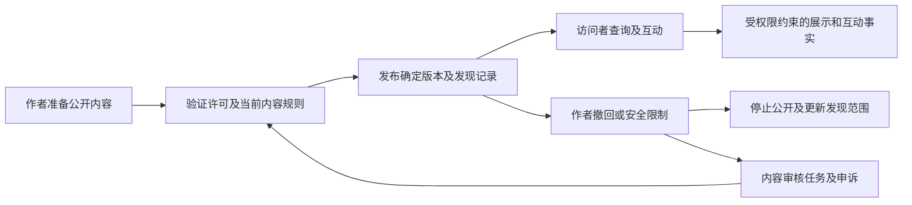

搜索、推荐和缓存只能反映仍可见的内容，不能绕过撤回或权限。重复点赞/关注表示一个关系，取消是反向关系命令；评论编辑保留所需版本和治理证据。业务数据已发布而发现更新失败时保留待同步责任，不让不可见内容泄露。人工审核的决定和后续可见性变更必须可核实。单次发布/互动以事实及必要可见性成立结束；内容生命周期继续至撤回或依法处置。排序目标、限制说明和申诉窗口待 Q06。

### F06 商品供给、审核与版本变更

**目标/参与者**：卖家提供可兑现的内容与许可；审核人员确认供给资格；平台记录可接受版本。输入为资产版本、许可证据、价格币种、交付清单、退款条款与 AI 披露；前置为卖家身份和收款能力合格、内容安全且售卖权可证明。

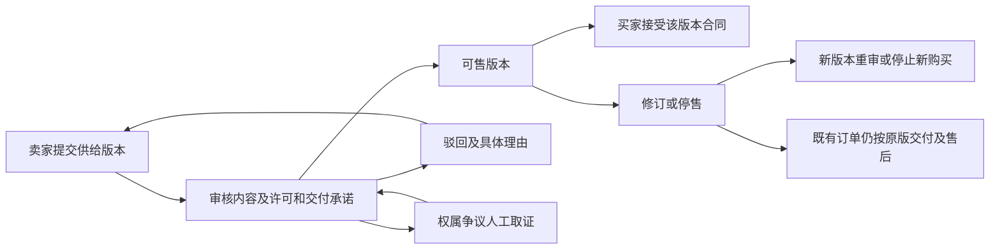

审查失败不创建可付款订单；停售只停止新承诺，不消除旧买家权利。若旧版本不再合法可供，必须关联受影响订单进入安全限制和售后，不能静默替换内容。后置为目录更新、卖家通知及必要的存量订单风险案件。一次上架以可售或有理由拒绝结束；合同版本不可被之后价格、分类或许可编辑改写。审核门槛及许可包待 Q05/Q06。

### F07 商品购买与数字交付

**目标/参与者**：买家付款后得到所接受的内容及许可；平台核实、履约，财务/交付运营负责异常。输入是供给版本、买家接受证据、价格币种与交付清单；前置为可售、买卖身份合格、无冲突权益且能准备承诺内容。

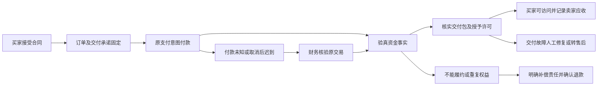

履约确认需要资金、合同、接收人、内容版本四者一致。买家访问失败可以发起交付修复，不能把“能生成下载地址”当作货已到。重复付款事件不重复发货；另一个真实付款不得被简单丢弃，须建立多付资金责任。未支付取消需确认支付窗口；取消后收到钱仍须退款或合法的新接受决定，不能无授权恢复旧订单。后置是通知、结算、售后资格。订单“已交付”不等待卖家银行到账；整体资金链按 F09 独立收敛。

### F08 商品售后、退款、争议与撤权

**目标/参与者**：按合同和有效裁决纠正交易结果。买家/支付机构发起，客服收证，授权裁决者决定，财务核实执行。输入为原订单、请求原因、争议类型、金额和证据；前置为原合同可追溯、避免同一责任重复退款、裁决者具备权限。

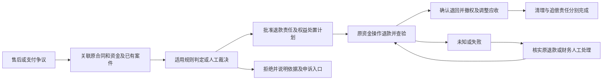

未知退款不能新建第二笔代替查询；退款/拒付/平台赔付对同一损失须累计核对。申请阶段是否限制下载与退款失败后的恢复规则待 Q07，不预设申请就永久撤权。确认退款后，在线访问及可复用授权按裁决收回，已下载副本无法远程召回。卖家已提现时，退款与追偿是关联但独立责任；不能虚构已追回，也不能未经批准以追偿未完成为由无限拖延买家退款（资金承担 Q08）。结束分别确认买家款项、权益处置、追偿与清理；申诉建立新复核版本，不改写原决定证据。

### F09 卖家结算、提现、银行退回与追偿

**目标/参与者**：将合法应收转为正确账户的已核实收款，同时避免重复支出。卖家申请，财务运营审批，支付/银行产生结果。输入为来源订单、应收分配、账户域、资格规则和目标账户；前置是资金可支出、无影响该金额的未知事实或冻结，收款人身份一致。

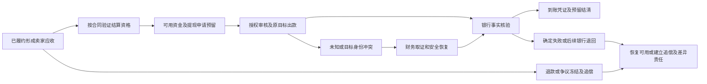

平台内部划拨、支付商余额和银行到账分别展示。银行已到账后退回不能把原到账证据改成“从未发生”，应记录关联退回事实。资金未知时保留相应预留，不能仅因过时释放后再次提现；查明确未出款才释放。身份修正必须验证原账户域和操作，禁止替换目标后重放旧命令。结束由实际出款、失败释放或获批处置凭证确定；损失核销须保留真实损失而非制造收款记录。冻结期、费用、损失承担与核销权限待 Q08。

### F10 委托发布、承接、制作、验收与争议

**目标/参与者**：委托人获得约定交付，创作者获得对应报酬；双方确认合同，争议裁决者处理分歧。输入为需求、交付类型、报价、期限、许可及 AI 披露；前置为双方资格、内容约束及支持的资金方式明确。

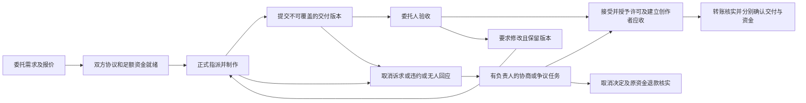

正式指派须同时满足合同与资金条件，不因单方发出报价就开始计入履约责任。开放委托可按规则到期关闭，任何收到的资金仍须核实退回；已指派不以时钟单独授权支付。延期必须得到另一方有效同意；变更前合同继续有效。验收绑定明确版本和许可，转账异常不撤回已成立验收事实。长期不审阅触发提醒、分派和升级，自动验收与分阶段/部分赔付待 Q09，不预设。失败或退款终态也必须释放相应责任；身份不符进入财务人工任务，核验后能恢复原操作。结束必须说明交付、资金、争议各自结果。

### F11 风险、内容治理与申诉

**目标/参与者**：对有依据的风险采取可解释、可复核的措施。举报者/系统产出信号，审核人员决定，申诉人提供反证。输入为来源事件、对象、规则版本、证据与受影响范围；前置是信号可去重、处理权限与事实范围明确。

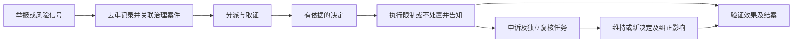

评分不是欺诈事实；风险审核不能隐式裁决资金。涉及商品/账户限制时，必须同时检查既有付款、交付、申诉与隐私权利，形成下游责任，不以封号清掉债务。重复信号合并来源，不能重复处罚；执行失败保留案件待确认。结束需要决定、影响范围、执行证据与有效申诉说明；申诉期限及审核独立性待 Q06/Q12。

### F12 站内通知与阅读

**目标/参与者**：用户能够发现与自己相关的业务事实；领域产生通知责任，交付服务处理，客服/运营接管失败。输入为事实事件、收件人、内容与可访问目标；前置为主体归属有效，偏好及必达分类适用。

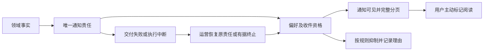

已读仅由明确阅读操作或获批语义改变；发送重试不得把已读清回未读，也不重复建立逻辑通知。页面刷新、分页和相同时间戳不得造成漏项。取消来源业务不删除已经发生的历史通知，可发新的状态更正。后置为未读统计及合法保留清理。交付结束为可见、合理抑制或有责任人批准的失败处置，不能以最终执行失败静默遗失；阅读不是交付必需终点。必达通知与偏好冲突待 Q10。

### F13 开发者授权、凭证轮换与撤销

**目标/参与者**：让外部程序仅在用户明确授权范围内访问。所有者创建服务身份，平台校验每次访问，安全运营处理泄露。输入为所有者、允许业务范围、期限和来源限制；前置是用户资格有效且该能力确实对机器开放。

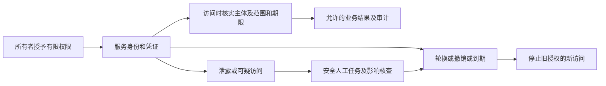

机器能力不能因网站已有同名功能而自动开放。撤销后新访问不得继续；撤销时已经发起的有副作用业务依原业务取消/核验规则处理，不声称已撤回外部执行。轮换是新凭证替代，不复活旧凭证。结束为明确授权、到期或撤销且影响可查。当前只有有限身份读取能力，目标保留“逐项授权”边界；新增交易/创作能力须单独业务批准（Q13）。

### F14 外部事件订阅与 Webhook 交付

**目标/参与者**：把已发生的事实送至授权接收方并保留交付证据。用户配置端点，平台发送，接收方确认与去重，集成运营处理死信。输入为不可变事件身份、范围、端点和当时签名版本；前置为订阅有效且事件允许披露。

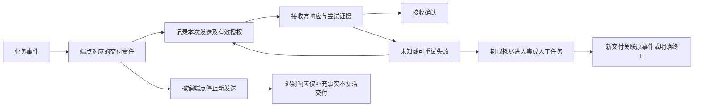

接收方响应只证明约定的接收事实，不证明其内部业务完成。重复发送保持事件身份；人工重放形成新交付责任，但接收方仍按原事件去重。撤销不能收回已发出的数据，迟到证据必须保留且不能覆盖撤销决定。最终执行中断要进入可操作目录。重试次数与最长交付窗口待 Q10；无限重试不是闭环。

### F15 客服与业务问题解决

**目标/参与者**：把用户问题连接到真正有权解决的业务责任。用户提问、客服沟通、相应领域负责人处理。输入为问题、关联对象、受影响人及必要证据；前置为关联资源对客服可见、敏感信息最小化。

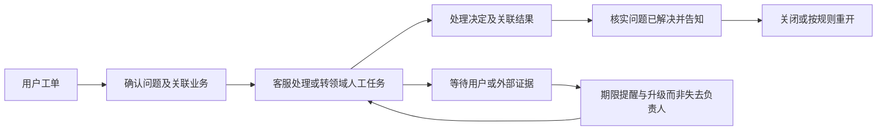

退款问题的解决证据是退款结果而非“已提交退款”；建议类问答可用答复完成。无法解决可明确以相应原因结束沟通，但原资金/隐私责任不得消失。转交在新负责人接受前仍由原负责人跟踪。重复投诉关联同一根因，独立用户权益分别处理。关闭、重开时限及无回复结束口径待 Q12。

### F16 个人数据导出

**目标/参与者**：本人取得授权范围内可读且可核验的数据副本；平台制作，隐私运营处理失败。输入为身份再确认、范围及请求时间；前置为本人有权获取，排除他人及依法限制部分并说明理由。

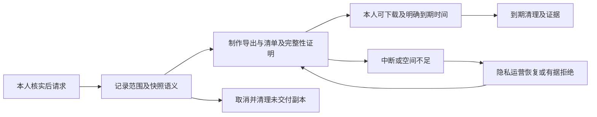

下载不是公开分享；凭证失效或主体变化需重新核实。导出中数据变化采用已告知的截点语义，不拼成无法说明的历史。用户不下载不阻止导出服务完成；副本到期清理是独立必须责任。制作失败不返回空包当成功；部分排除必须有清单和理由。完成分别记录可获取事实与副本清理；范围、期限和响应 SLA 待 Q11。

### F17 注销、保留与分范围删除

**目标/参与者**：停止账户新业务并按合法范围清理数据，同时完成不能因注销消失的责任。用户申请，隐私负责人管理，财务处理未结款，运维和处理商提供清理证据。输入为身份确认、数据范围、未结责任及合法保留依据。

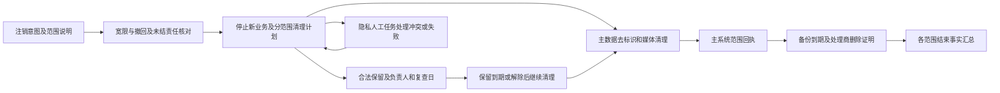

申请可撤回的截止点必须事先说明；不可逆去标识后不承诺恢复旧账户（Q11）。删号不得阻止原退款、卖家合法收款或申诉必要访问，应提供受限核实渠道；也不能允许迟到生成恢复私有数据。主系统完成不结束备份/处理商责任。备份恢复时须重新应用已批准删除和限制；用户自己下载的副本不属于平台可删除范围。无法取得外部证明时明确“外部待核实”，有责任人及复查日，绝不伪称全面删除。

### F18 成本/资金核对、媒体盘点与差异处置

**目标/参与者**：发现并追踪业务事实与外部事实差额。财务或运维发起，供应商给证据，相应领域负责人纠正。输入为核对范围、期间、来源水位、金额/用量/对象清单；前置为来源可识别且口径一致。

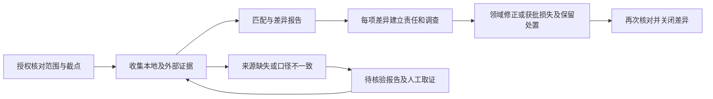

聚合成本差异不能直接推断某一用户欠款；存储孤儿候选不能直接授权删除。部分来源缺失须标识覆盖率，禁止出“全部一致”报告。重跑生成新报告版本并引用原差异，不重复作账务调整。报告生成与差异结案是两层终态。核销、容差、核对频率与凭证要求待 Q08/Q14。

### F19 业务规则、供应商能力与运营变更

**目标/参与者**：使定价、模型能力、分类、权限、开关和治理政策的变化不破坏已承诺业务。规则负责人提案，授权审批者批准，受影响领域负责人验证。输入为新旧规则、依据、影响范围、生效时间和退出安排；前置为变更者权限和供应商能力有证据。

```mermaid
flowchart LR
 A[运营提出业务变更] --> B[核对存量承诺及供应商能力]
 B --> C[批准版本与生效范围]
 C --> D[新业务应用新版本]
 C --> E[旧合同继续按原约定或经有效变更]
 D --> F[观察结果并记录审计]
 B --> G[规则冲突或能力不支持]
 G --> H[业务负责人补充决策]
 F --> I[撤回新准入并处理受影响责任]
```

关闭新购买/生成不应顺带关闭原退款、交付恢复或隐私履责。切换商户、模型或分类不能把旧操作的执行身份换成新配置。模型不可用时替换模型涉及结果和计价承诺，必须满足已接受的替代规则或再次取得用户同意。变更结束以可用版本、明确影响和必要补偿成立为准；具体准入、回滚和能力替代政策待 Q14。

### 3.20 完成确认及后置义务总表

本表补足流程图中容易被省略的“谁确认”与“确认以后还欠什么”。确认者代表业务责任，不表示必须全部人工审批；有充分证据时系统可按已批准规则确认。

| 业务 | 谁确认/确认给谁 | 必须交付的输出 | 后置义务及失败接管 |
|---|---|---|---|
| F01 | 认证服务依据证明向本人确认；争议由安全 owner | 会话或身份变更事实及适用权限 | 安全告知、失效授权处置；投递失败仍由安全通知责任跟踪 |
| F02 | 计费依据资金向购买者确认 | 账目、期间资格/额度及接受条款 | 到期、通知、退费义务；授予异常由计费/财务接管 |
| F03 | 结果与计费核实向创作者确认 | 每子项文本/媒体或明确终止结果，预留去向 | 输出保留/清理、通知及成本核对；未结尝试由创作运营负责 |
| F04 | 扫描/完整性及授权判定向资产使用者确认 | 可用版本或隔离理由、用途范围 | 引用保护、删除和保留复查；安全/存储 owner 接管失败 |
| F05 | 内容服务向作者及有权访问者确认 | 公开/撤回/受限事实、有效互动 | 发现同步、治理与告知；内容 owner 核实实际可见性 |
| F06 | 审核角色向卖家确认，平台对买家提供有效版本 | 可售供给或拒绝依据 | 目录同步、存量承诺保护；供给 owner 追踪失败 |
| F07 | 履约核实向买家确认，资金向卖家记录应收 | 符合合同的可访问交付与权益 | 通知、售后、结算；买家交付完成不消除财务后续 |
| F08 | 有权裁决及远端核验分别向买家/卖家确认 | 决定、退款证据、权益状态、后续责任 | 追偿、清理、申诉；各子责任有 owner，不能只关售后单 |
| F09 | 财务依据银行证据向卖家确认 | 到账/确定失败/退回凭证及余额解释 | 后续退回或追偿，正式损失决定；财务保持责任 |
| F10 | 委托人或有权仲裁者确认交付，财务确认资金 | 接受/取消决定、具体交付许可与对应资金结果 | 转账/退款、通知与申诉；交付和财务 owner 分别跟踪 |
| F11 | 有权审核/复核者向相关方确认 | 有依据的决定和实际影响 | 申诉、受影响交易处置；治理 owner 不把金融问题藏在封禁里 |
| F12 | 交付服务确认可见，用户本人确认阅读 | 可查询通知或有理由抑制/终止 | 未读统计和保留清理；通知 owner 恢复失败，阅读非必需义务 |
| F13 | 授权服务向所有者确认 | 有效范围、期限与撤销/轮换结果 | 安全告知、在途业务核查；安全 owner 跟踪泄露影响 |
| F14 | 按接收协议向订阅所有者确认 | 每次尝试、接收或失败证据 | 死信接管、重放、事件保留；集成 owner 负责，接收方内部处理另约 |
| F15 | 客服核实关联结果后向用户确认 | 问题答复、解决依据或明确未解决原因 | 重开/转交及原领域责任；客服关单不代替接管确认 |
| F16 | 隐私服务核实包和权限后向本人确认 | 可获取导出、范围清单及到期信息 | 到期副本清理；清理异常仍由隐私/存储 owner 跟踪 |
| F17 | 隐私 owner 依据各执行方凭证向本人确认 | 分范围回执、保留依据与外部待办说明 | 保留到期、备份恢复重施删除、处理商证明；未完范围保留 owner |
| F18 | 核对者向责任管理者确认报告，领域 owner 确认差异解决 | 覆盖范围、差异、处置及复核证据 | 残余差异、后续新证据；不随报告生成关闭 |
| F19 | 规则批准者和适用结果核验者向受影响业务确认 | 有效版本、时间范围、存量安排及告知 | 观察、退出或补偿；规则 owner 核实受影响承诺 |

这 19 条业务不是必须按顺序全部执行：用户可以只创作而不交易，只上传而不公开，也可以只购买而不创作。跨业务箭头是有前置条件的协作关系，不是强制捆绑销售或流程依赖。

## 4. 业务状态机

### 4.1 状态设计原则及共用子流程

业务决定、外部执行、资金、权益、人工案件分别拥有状态。不得把所有维度压成一个万能 status，也不要求每个流程都具备“暂停”。本节状态是第 3 节流程的可判定映射；任意未列转换默认不允许，新增转换必须说明触发者、证据、权限及后续责任。

| 共用状态 | 为什么存在/进入条件 | 离开条件 | 负责方 |
|---|---|---|---|
| 待处理 | 已接受业务责任，尚未执行 | 前置满足进入执行；有效取消进入终止处理 | 对应领域执行者 |
| 执行中 | 已取得当前处理权，执行事实可追溯 | 有结果进入确认；中断/超时按是否可能外部生效分流 | 当前执行者，失联由领域恢复责任接管 |
| 待核验 | 可能已发生外部副作用，不能断言成功/失败 | 同源凭证确认、确定未发生证据，或升级正式人工 | 资金/供应商核验角色 |
| 待人工 | 自动证据不足、规则冲突或必须裁决 | 合法决定被核实后回到原业务动作；不能凭“已处理”结束 | 已指派负责人及升级负责人 |
| 确定失败 | 有证据未交付/未发生预期结果，且原尝试不再有未知责任 | 已获允许的恢复尝试，或结清剩余责任；若新服务则建立新请求 | 原业务 owner |
| 取消处理中 | 取消意图已接受，但外部执行或资金仍需处置 | 停止/补偿证据及对应账务完成才取消完成 | 原业务 owner |
| 明确终态 | 成功、拒绝、取消、过期、依法保留终结等各有具体事实 | 不可覆盖；后续纠错通过关联的新事实/案件 | 事实保管者及必要复核者 |

“超时”是触发事件：验证码到期可直接终止；外部付款超时必须待核验；已交付未验收超时进入催办/仲裁。它不是所有业务通用的失败结论。

“确定失败后重试”指该操作的某次尝试已确定没有生效，原业务责任尚未终结；保留失败尝试，创建获准的新尝试。已向用户作出且完成补偿的整项服务终态不得倒退，重新服务必须是用户同意的新业务。合法保留可暂时履行某项“不应立即删除”的法律义务，但不代表数据已删除，仍须有到期/复查责任；只有明确的拒绝请求决定才是请求的拒绝终态。

```mermaid
stateDiagram-v2
 [*] --> prepared: 接受原操作及原身份
 prepared --> dispatched: 前置与权限成立
 prepared --> cancelled: 确认未发送并有效取消
 dispatched --> confirmed: 同源成功证据
 dispatched --> definite_failure: 同源确定失败
 dispatched --> uncertain: 超时或发送结果丢失
 uncertain --> confirmed: 查询或回调验真
 uncertain --> definite_failure: 证明确未发生
 uncertain --> manual: 证据冲突或核验期限到
 manual --> uncertain: 取得核验线索
 manual --> confirmed: 有权确认且证据成立
 manual --> definite_failure: 有权确认未发生
 definite_failure --> prepared: 获准重试且原操作可安全复用
 confirmed --> [*]
 cancelled --> [*]
 note right of manual
   无证据不得为了结案伪造失败或成功
   获批补偿可结束用户服务责任
   原外部不明责任仍须独立跟踪
 end note
```

### 4.2 各业务专有状态及转换条件

以下各行列出正常、异常和终态；通用执行中的未知/人工分支使用 4.1，但保留本领域身份及 owner。箭头上的事件是进入目标状态的条件；无法满足条件不得跳转。终态后的售后、退回、申诉建立关联流程而不是倒写历史。

| 业务 | 专有状态机与存在理由 | 退出责任及约束 |
|---|---|---|
| F01 身份 | 待验证—正确证明→已消费；待验证—过期/撤销/次数耗尽→不可消费；会话有效—到期/撤销→失效 | 认证服务；待投递并不改变验证期限，安全人工只能重新核实不能复活已消费证明 |
| F02 服务资格 | 待付款—资金确认→待授予—资格入账→购买完成；订阅待生效—约定起点→有效—约定终点→到期；不能授予→补偿待确认→已补偿 | 计费/财务；续期与提前终止须 Q02/Q03，不能用已付款跳过资格授予 |
| F03 生成 | 已接受→已预留→执行中→结果待验证→可交付；执行确定失败→释放完成；取消请求→取消处理中→取消完成；批次未定→部分已定→全部已定 | 创作运营；结果待验证用于防“拿到 URL 即成功”；全部已定仍须检查预留结清 |
| F04 资产 | 接收中→待检验→可用；检验拒绝→隔离；未知→待检验；可用/隔离→待清理→清理完成或有依据保留 | 内容安全/存储；保留须范围、依据和复查日，不得无限隐藏责任 |
| F05 社区 | 草稿—许可和规则满足→公开；公开—作者撤回→已撤回；公开—治理决定→受限；受限—有效复核→公开或撤回 | 作者/治理；发现索引与公开许可一致，申诉本身不自动恢复公开 |
| F06 供给 | 草稿→审核中→可售/驳回；可售→停售；修订生成新草稿版本 | 审核员/卖家；停售不撤销已接受合同，不允许审核中对外收款承诺 |
| F07 购买 | 待付款→付款已确认→交付待确认→已交付；未付取消确认→已取消；已付不能履约→补偿待确认→补偿完成 | 履约/财务；付款与交付允许观察到不同进度，必须存在未交付责任 |
| F08 售后 | 已申请→审查/取证→批准/拒绝；批准→退款核验中→退回确认→权益处置确认；追偿/清理未结则案件保留对应子责任 | 裁决者/财务/资产；拒绝有依据且告知申诉；未知不能作退款失败终态 |
| F09 资金 | 应收待结算→合格可用→提现预留→出款核验→到账确认；拒绝或确定未出款→释放；到账后退回→关联退回及差异；追偿待办→已追回/有权核销 | 财务；核销是损失决定，不能等同已追回，资格时点待 Q08 |
| F10 委托 | 开放→协议与资金就绪→已指派→已提交→已接受；已提交→待修改→再提交；开放→取消；在制/提交→争议→接受或取消执行 | 双方及仲裁；每交付版本独立，自动验收须 Q09；财务状态独立跟踪 |
| F11 治理 | 已记录→已分派→调查中→决定待执行→执行已核实→关闭；申诉创建复核案件→维持/纠正 | 审核/复核者；信号数量和案件数量分离，风险分不作裁决 |
| F12 通知 | 待交付→可见/已抑制；失败→待恢复→重投/有据终止；可见通知未读→已读 | 通知责任角色；失败不能伪作已抑制，阅读与交付状态互不覆盖 |
| F13 授权 | 待签发→有效→撤销/到期/已替代；安全冻结→经批准恢复或撤销 | 所有者/安全运营；未授权范围永不因凭证有效而放行 |
| F14 事件交付 | 待发送→发送中→已接收/待重试；失联/尝试耗尽→待人工；撤销→已取消；重放建立新 delivery | 集成运营；取消后响应仅记录，不能返回发送中或成功；实际已发出事实保留 |
| F15 客服 | 新建→已分派→处理中/等待材料→待核实解决→已解决→关闭；新证据→关联重开 | 客服；等待材料仍有期限及 owner，原责任不随工单结束 |
| F16 导出 | 已接受→制作中→可获取→已到期→副本清理完成；拒绝/取消须理由及临时副本清理 | 隐私/存储运营；可获取必须实际授权可读，未下载不是制作失败 |
| F17 删除 | 宽限中→范围核对→清理中；各范围进入完成/合法保留/外部待核验；宽限内撤回→撤回确认 | 隐私 owner；申请总体是各范围投影，不得用单个完成覆盖未决范围 |
| F18 核对 | 已受理→收集中→完整报告/有缺口报告；差异已分派→调查→修正待核实/有权处置→关闭 | 财务/运维；报告终态不自动关闭差异；缺口报告不能宣称无差异 |
| F19 规则 | 提议→影响验证→已批准→已生效→被替代/撤回；冲突→待决定 | 业务规则 owner；批准不等于已生效，紧急撤回也需处理已有承诺 |

### 4.3 委托的交付与资金双状态示例

```mermaid
stateDiagram-v2
 state 交付 {
  [*] --> 制作中
  制作中 --> 已提交: 创作者提交版本
  已提交 --> 修改中: 委托人有据要求修改
  修改中 --> 已提交: 新版本
  已提交 --> 已接受: 有效验收或仲裁
  制作中 --> 争议: 违约或有效争议
  已提交 --> 争议: 验收分歧或升级
  争议 --> 已接受: 支持交付的有效决定
  争议 --> 已取消: 取消决定
 }
 state 资金 {
  [*] --> 资金就绪
  资金就绪 --> 应付创作者: 交付有效接受
  资金就绪 --> 应退委托人: 有效取消
  应付创作者 --> 转账待核验: 原目标执行
  应退委托人 --> 退款待核验: 原付款执行
  转账待核验 --> 创作者收款确认: 外部证据
  退款待核验 --> 退款确认: 外部证据
  转账待核验 --> 财务人工: 身份冲突或长期未知
  退款待核验 --> 财务人工: 身份冲突或长期未知
  财务人工 --> 转账待核验: 核实原转账责任
  财务人工 --> 退款待核验: 核实原退款责任
 }
```

最后两条人工出口只能回到该任务原本的责任类型，不能把应付创作者的案件任意改成退款；改变裁决必须走有权复核并形成新决定。

### 4.4 时间与重试的业务约束

| 时间概念 | 到期触发什么 | 不允许的解释 |
|---|---|---|
| 身份证明有效期 | 拒绝继续消费，按资格重新申请 | 投递延迟自动无限延长 |
| 支付窗口 | 关闭新增付款接受窗口并核实可能在途原交易 | 本地过期证明外部绝未扣款 |
| 服务处理/交付期限 | 催办、查验、升级或合同规定补偿 | 时间到了自动构造成功结果 |
| 验收与争议期限 | 按接受条款提醒及升级；自动决定须已批准 | 用系统默认值追溯剥夺旧任务权利 |
| 核验/重试期限 | 自动阶段结束转有责人工，保留原身份和资金约束 | 达到最大次数就债务消失 |
| 人工领取/响应期限 | 升级到已指定责任主管，转交有承接 | 把 owner 清空重新排队即算处理 |
| 通知/事件有效窗口 | 按内容和承诺终止或人工处置，记录依据 | 消息未投递就默认为用户已知 |
| 导出/保留/备份期限 | 到期清理或依法复查，并保存证据 | 一次设置期限后不验证执行结果 |

每个业务保存当时适用的期限规则，展示可理解的绝对时间及所需时区。重试上限、间隔和最长核验窗口由服务承诺和供应商能力共同决定，参数批准前列 Q04/Q10/Q12/Q14；本报告只规定边界和耗尽后的责任，不编造具体数值。

## 5. 业务规则

### 5.1 规则来源与处理决定

“必须保留”指保留所保护的业务不变量，不要求保留当前实现方式。以下为本阶段目标规则目录；商业参数由 Qxx 决定，不能把本表当成已经批准的收费或法律条款。

| 编号 | 现状/规则来源及判断 | To-Be 规范 | 类别与待确认 |
|---|---|---|---|
| R01 | 身份证明有用途、有效期和消费记录；合理 | 身份行为必须匹配用途和本人，已消费证据不得复活；变更后旧授权影响须明确 | 已有、必须保留；Q01 |
| R02 | 资源访问结合归属/来源/许可；合理 | 所有读取与使用按当前有效授权判定；所有权、可读、可生成引用、可公开、可售卖分别授权 | 已有、必须保留；许可商业范围 Q05 |
| R03 | 资金与积分分开；合理 | 金额有币种与账户域，积分有计量和适用范围，不跨域挪用或暗中兑换 | 已有、必须保留；兑换/到期 Q02 |
| R04 | 预留、capture、release；合理 | 一份服务消耗最多确认一次；确定终止后不得留下有效预留；未确认外部责任不通过释放资金制造可再次支出 | 已有、必须保留；取消消费政策 Q04 |
| R05 | 套餐/付款存在条款快照 | 服务期间、额度、模型资格按接受版本兑现；套餐修改不悄悄减少已购权利 | 已有设计应保留；升级/续期规则 Q02 |
| R06 | 生成服务端按命令键去重，批次前端重提不保留键 | 同一意图的恢复必须返回同一子业务；明确新增意图才能新计费；部分成功逐项展示 | 存在问题、必须补齐；B03 |
| R07 | 本地扣积分一次不等于模型执行一次 | 执行尝试、用户消耗和外部成本分别记录；未知远端结果先核验；能力不足时按获批风险预算处理 | 缺失边界、需局部重建；B08/Q04 |
| R08 | 上传扫描与引用保护存在 | 检验未知不当作安全；删除按引用和保留规则执行；证据不足不自动清理 | 已有、必须保留；Q05/Q11 |
| R09 | 作品发布与商品上架独立 | 公开不自动授予商业许可；内容变更不自动修改已卖版本 | 已有、必须保留 |
| R10 | 商品合同/交付快照固定 | 接受合同后内容、价款、许可和交付清单不可单方改写；新条款必须新版本或有效双方变更 | 已有、必须保留 |
| R11 | 支付按原身份、金额、币种核实 | 只有来源一致的资金事实可驱动履约；成功跳转和截图不能代替支付凭证 | 已有、必须保留 |
| R12 | 商品有补偿，任务核验覆盖不均 | 取消/到期/不能履约后的迟到付款必须形成可追溯返还或经批准的新承诺；每笔钱有人负责 | 已有但不完整；B01/B02/B07 |
| R13 | 任务 recovery_required 安全停止但无出口 | 安全停止保留；同一案件必须能凭原身份和结果证据恢复、确认或正式处置，绝不直接改成功 | 存在问题；B01 |
| R14 | 有 refund ID 的任务退款等待回调 | 回调与主动查验都是证据渠道；未收到回调不应使责任失去 owner；查询必须针对原退款 | 缺失；B02 |
| R15 | 商品退款窗口从订单创建时按日计算；理由 10–500 字符 | 必须向买家明确窗口起点、截止及迟到付款影响；目标起点由商业承诺决定，不沿用代码即视为正确 | 现规则待重判；Q07；理由长度属交互约束，不决定退款权利 |
| R16 | 退款确认伴随撤权与结算调整 | 对同一责任已退、拒付、补偿须汇总防双返；权益状态与裁决一致；已下载文件不能声称已召回 | 已有基础、跨来源范围待核验；Q07/Q08 |
| R17 | 卖家资金分账户域，未知阻止支出 | 只有来源和归属可证明的金额可提现；请求未定不得释放后再花；收益、费用、冻结和追偿独立说明 | 已有、必须保留；Q08 |
| R18 | 任务 open 自动到期，已指派需参与者或仲裁 | 时钟可催办升级，不单独授权付款；任何自动验收都必须来自预先接受的政策 | 已有底线保留；缺少时限责任 B09/Q09 |
| R19 | 委托延期需要双方确认；许可从合同授予 | 单方不得延长履约期限；验收绑定交付版本；衍生许可按明确约定，不能默认全权转让 | 已有、必须保留；Q05/Q09 |
| R20 | 风险信号和有理由的版本化人工 review 存在 | 信号只触发调查；处置须可解释并跟踪效果；风险审核不是退款授权 | 已有、必须保留；Q06/Q12 |
| R21 | 人工入口分散、部分缺 SLA | 每个待人工责任都必须有接管角色、负责人、期限、转交记录和结束证据；客服关单不抹去领域责任 | 缺失/需重建；B09/Q12 |
| R22 | 通知偏好、已读已分离，但可能漏项/孤儿 | 通知必须完整可检索；失败显式可恢复；可见、阅读、抑制分别有事实 | 直接修复及局部调整；B05/B06/Q10 |
| R23 | Webhook 有重试及死信，撤销可能被晚回写覆盖 | 撤销决定不被旧尝试覆盖；发送事实仍保留；接收方以事件去重；死信有正式责任 | 直接修复及局部调整；B04/B05/Q10 |
| R24 | 机器凭证当前限身份读取 | 默认只授予已批准能力，机器身份不扩大本人资格；轮换/撤销不能漏掉在途影响评估 | 已有、必须保留；Q13 |
| R25 | 导出、删除及 legal hold 已有；备份外部阻塞 | 每个范围有明确事实、合法依据和 owner；本地主库完成不得被解读为全部删除 | 已有基础、完成模型需重建；B10/Q11 |
| R26 | 成本核对产生报告 | 报告与差异处置分离；未知不写零；每个差异最终有核实结果或获批处置 | 目标扩展，现状非全平台核对；Q14 |
| R27 | 运营开关控制新业务，配置影响执行 | 变更有适用时间与范围；停止新业务不得阻断旧债务履行；供应商切换不改原交易身份 | 已有基础、目标补充；Q14 |
| R28 | 部分路径有命令身份、版本和审计 | 业务决定须可追溯且冲突受控；重试不产生第二个经济结果，纠错用新证据/调整而非抹原史 | 已有设计推广，跨流程检查 |
| R29 | 通用执行最终失败不总同步领域责任 | 业务终结必须核对领域结果及后续义务；执行次数耗尽只能触发接管，不视为责任已结束 | 缺失；B05 |
| R30 | 外部事实与系统状态可不同步 | 可允许暂时不同，但必须记录“截至何时、依据什么、下一步谁核验”；未知不能被 UI 隐藏 | 必须新增统一业务要求，不要求统一状态实现 |

### 5.2 业务不变量

1. **唯一意图**：主体、操作、逻辑命令身份确定一个业务决定。相同身份但内容不同为冲突，不自动换身份掩盖。
2. **可追溯资金**：每笔入账/退回/转出都有原始业务、资金操作、账户域和证据；累计分配不得超过已确认可分配金额。
3. **不重复确认**：一份履约/验收只授予一组对应权益；同一付款事实不重复入账；重复事件仍保留必要接收证据。
4. **未知不释放**：存在可能生效的资金操作时，不得凭网络错误释放资金并创建第二个独立操作。
5. **权利来自合同**：交付人、接收人、内容版本与许可能互相追溯；内容被下载不意味着许可永久不可撤销，也不意味着能物理召回。
6. **终态不倒写**：取消后的迟到响应、提现后的银行退回、结案后的申诉均保留原事实并追加新决定。
7. **责任不断链**：领域事实引发的必要后续动作即使失败也有独立身份、负责人和期限，不随执行器消失。
8. **隐私不复活**：删除/限制与迟到写入之间必须遵循有效决定；备份恢复不得重新公开已删除数据。
9. **无权不恢复**：人工有权限、证据及当时对象版本；不能用客服备注、风险评分或全局管理员身份代替领域授权。
10. **商定参数优先**：价格、退款、期限和许可按双方接受的版本；缺少规则不能通过“默认当前配置”猜填。

## 6. 异常处理模型

### 6.1 先判断事实，再决定动作

```mermaid
flowchart TD
 A[遇到异常或超时] --> B{可能已经产生外部副作用吗}
 B -->|没有且有证据| C[确定失败或按规则安全重试]
 B -->|有或无法确定| D[记录未知事实与原操作身份]
 D --> E{有可验证的查询或回调吗}
 E -->|有| F[查验原操作并比对对象金额和账户域]
 F --> G{结果}
 G -->|成功| H[确认原业务及必要后续]
 G -->|确定未发生或失败| C
 G -->|冲突或仍未知| I[带期限的人工任务]
 E -->|没有| I
 I --> J[取证或经批准的用户补偿]
 J --> K[业务服务责任与外部未知责任分别追踪]
```

不承诺外部系统永不提供证据时仍能自动“证明成功或失败”。目标是有限期自动处置加明确升级；如果外部事实永远不明，可按批准规则补偿用户、承认损失或保留争议，但必须准确保留未知。正式责任承担与事实确认是不同决定。

### 6.2 七类必备异常及适用性

| 场景 | To-Be 实际处理 | 可重试/可取消的界限 | 必须留下的数据 |
|---|---|---|---|
| 用户取消 | 先确认取消权限和生效阶段；未开始且无外部责任可停止，已执行进入停止/补偿核验；已交付进入售后 | 关页不是取消；已发送的钱不能靠本地取消当未发生 | 取消意图、接受/拒绝理由、竞争决定、补偿关联 |
| 系统宕机/存储失败 | 恢复时从业务承诺、执行事实和已有结果继续；确认缺少哪个责任，接管失联执行 | 不因执行器重启重建原业务；未归属内容先查引用再清理 | 原请求、尝试、结果证据、接管记录及未完动作 |
| 第三方超时 | 根据是否可能发送成功进入核验；查询原操作或等已定义窗口内的回调 | 对付款/退款/出款，未知不能盲目新发；对生成按供应商能力与已批准成本策略 | 发送事实、超时点、可用的远端标识、下一核验时间 |
| 第三方未知/证据冲突 | 保持待核验，限制对应金额或结果对外承诺，升级有责人工 | 客服口头确认不替代凭证；商户身份冲突不能换当前商户重试 | 各条证据及其来源时间、冲突范围、owner |
| 部分成功 | 保留已成立结果；对子项及后续责任单独恢复或按合同补偿 | 生成批次不整体重做；退款已退但追偿未完成不得再次退给买家 | 批次/父业务、子项状态、剩余责任、补偿决定 |
| 重复请求/回调 | 同意图返回原结果，重复事实只确认一次，内容不同拒绝为冲突 | 新尝试不是新经济责任；新购买/再生成是明确的新意图 | 逻辑命令、内容摘要、原结果、接收记录 |
| 并发处理/迟到返回 | 同一业务只接受与当前有效决定相容的转换；落后执行仅补充证据 | 旧执行不能撤销新取消；双重验收只能一个有效决定；已真实发生的另一笔款要立独立责任 | 决定版本、有效执行身份、竞争结果、迟到事实 |

### 6.3 各核心业务异常出口矩阵

“不适用”必须有业务原因，不能机械为只读或既成事实添加取消。表内处理均接第 7 节人工模型；重复和并发的具体不变量给出在最后一列。

| 业务 | 取消/已结束再次操作 | 中断、超时、未知 | 部分成功与人工出口 | 重复/并发判定 |
|---|---|---|---|---|
| F01 | 撤销未消费证明；已消费不能取消身份证明事实 | 邮件未知不延长证明；消费结果先查原决定 | 邮件已发而证明撤销仍不可消费；安全 owner 核实 | 一次证明一次消费，登录与封禁按有效身份状态决定 |
| F02 | 未付关闭；已付按售后与期间规则 | 原支付核验，无法授予建立补偿 | 入账/资格只完成一部分时修复原授予，财务接管 | 同支付不能二次授予，订阅冲突按 Q02 |
| F03 | 未执行停止；在途核实；已成功另作售后或新生成 | 原尝试核验，不凭超时断言远端未生成 | 逐子项恢复；无查询能力由创作 owner 按批准策略处理 | 子命令身份稳定；结果确认与取消只能一个有效业务结果 |
| F04 | 取消上传清未归属对象；已引用删除另核对 | 字节/扫描未知不可对外使用 | 字节成功记录失败时查来源；存储/安全 owner | 同接收意图一个资产，删除与引用遵守同一有效顺序 |
| F05 | 撤回公开，不抹已发生互动证据 | 发现不同步保留修复责任；权限始终有效 | 部分可见性变更需治理追踪 | 同互动关系一份，撤回优先阻止新公开读取 |
| F06 | 草稿撤回/可售停售；旧合同继续 | 审核或发布中断按版本恢复 | 目录部分同步不允许无批准版本售卖 | 一次批准对应一版，审核旧版本不能使新内容自动可售 |
| F07 | 原支付确认前可申请取消；已付走履约或补偿 | 原资金核验；付款已成但未交付显式待履约 | 财务/交付 owner 恢复或退款 | 同事实不双发，独立多付单独处置 |
| F08 | 未执行退款可按政策撤回；已发起先核验 | 查原退款；拒付及退款并存核对累计返还 | 已退款但撤权失败优先接管撤权，不再退款 | 同责任不双返，裁决版本不相互覆盖 |
| F09 | 出款前有据释放；出款后先核验再追回 | 原目标原金额待核实；未知保持相应预留 | 银行成功但本地确认失败补录证据；财务接管 | 预留不被双花；迟到失败不覆盖已确认到账，追加纠正事实 |
| F10 | 开放取消；承接后协商/裁决；已接受不得任意撤销 | 资金核验；交付超时催办/升级 | 交付已接受而转账未完保持应付责任 | 一份正式指派；验收/争议按有效版本裁决 |
| F11 | 举报撤回不抹独立违规事实；已处置可申诉 | 执行未确认不得关闭案件 | 部分资源限制失败跟踪剩余影响 | 来源去重；裁决冲突交复核者，不重复处罚 |
| F12 | 未投递可依来源/政策取消；历史已读不撤回 | 最终失败进入恢复目录 | 一人失败不重投所有收件人 | 事件/收件人/渠道唯一，分页无漏项 |
| F13 | 撤销使新访问失效；已执行副作用走原业务 | 签发结果未知不得反复扩大授权 | 授权轮换/告知部分失败交安全 owner | 旧凭证不得复活，主体变更不继承他人授权 |
| F14 | 撤销阻止新发送；已发送事实无法抹除 | 同事件重投；最终死亡交集成 owner | 某端点失败不改业务事实；晚响应只补证据 | 接收方按事件去重，旧尝试不改新决定 |
| F15 | 用户关闭沟通不解除领域责任 | 失联提醒及升级 | 财务处理中不能标实际退款问题已解决 | 相同问题关联，重复转交只有一个当前负责人 |
| F16 | 未交付可取消并清临时副本；已下载不可召回 | 制作失败恢复原请求或有据拒绝 | 明示范围排除，不能空包充完整导出 | 一请求一有效交付版本，取消后迟到包不可开放 |
| F17 | 仅允许范围内撤回；不可逆动作不承诺回滚 | 各范围继续核实，备份待办不伪完成 | 主清理与外部保留分别回执，隐私 owner 跟踪 | 重复删除不复活数据；保留与删除须一个有效决定 |
| F18 | 可取消本次采集，已发现差异仍须有人负责 | 缺来源标不完整，不能判无差异 | 每差异分别处理，不因报告完成结束 | 纠正操作唯一；重跑不重调账/删对象 |
| F19 | 撤回新准入，既有责任有退出安排 | 生效状态未知先查实际适用版本 | 部分能力变更不能悄悄破坏已接受承诺 | 一范围一有效版本，旧业务按接受版本 |

### 6.4 关键竞争的业务裁决

- **取消与生成结果确认**：已有效确认交付的服务，取消转售后；取消先被有效接受时，晚结果保留证据但不自动重开订单/扣费。取消收费及外部成本按 Q04，不在本阶段编造。
- **关闭订单与付款成功**：付款真实性优先于本地“已取消”的视觉状态；不会自动重新发货，进入有据补偿或重新取得买家同意。
- **退款与提现**：同一来源金额不得同时作为可用提现和应退责任；已经外流则建立追偿/承担决定，不能通过改账掩盖负债。
- **验收与申诉/争议**：校验当前合同与交付版本；先成立的合法决定保留，后续异议进入复核，而非双方各自成功覆盖。
- **删除与迟到写入**：删除责任生效后不得恢复可识别内容；若依法必须保留，隔离到批准范围且不对用户业务重新公开。
- **端点撤销与回调结果**：撤销是权限决定，收到迟到响应是网络事实；两者同时为真，不能择一覆盖。

### 6.5 外部系统交互的业务合同

| 外部角色 | 发送前必须明确 | 可接受的返回事实 | 超时/未知及退出责任 |
|---|---|---|---|
| 支付机构 | 原商户/环境、付款人业务、金额币种、原操作身份 | 经验证的付款/退款/转账事实；同源查询与回调可交叉核对 | 能查询先查原操作；不能查询则财务取证，不以相同品牌名当同账户 |
| 银行/出款通道 | 最终收款主体、费用与清算口径、来源分配 | 到账、拒绝、退回各自的凭证和时间 | 在途不释放；后续退回建立新责任；机构退出仍需旧单查询安排 |
| 模型供应商 | 模型及能力、输入许可、用户服务条款与平台成本策略 | 可关联的执行/结果/用量；能力有据才承诺远端幂等或查询 | 无查询能力不得承诺可找回结果；由创作/财务 owner 按 Q04 决定承担 |
| 扫描服务 | 内容版本、扫描覆盖范围、拒绝与未知的含义 | 对该内容版本的明确判定及依据 | 故障保持不可用，进入重检/安全复核，不自动放行 |
| 对象存储/备份服务 | 对象归属、完整性、访问与保留范围 | 写入/读取/清理/保留证据，具体范围可追溯 | 不能读回不算交付；删除未知继续核验；退出先保护既有交付 |
| 邮件投递方 | 收件用途、有限期内容、保密范围 | 接收发送请求、投递/退信证据分别记录 | 发件成功不代表本人阅读；未知可能重复送达但证明仍只消费一次 |
| 外部事件接收方 | 授权范围、事件身份、接收确认协议、重复语义 | 接收响应，不默认等同其业务完成 | 稳定事件重投、撤销边界与迟到证据；集成 owner 接管死信 |
| 隐私数据处理商 | 处理范围、合法保留、删除/证明义务 | 覆盖特定范围的处理或保留证据 | 合同到期不自动证明已清除；隐私 owner 持续取证或披露阻塞 |

供应商“支持幂等”“支持退款查询”“支持取消生成”等能力必须有实际服务协议或验收证据，并按账户/版本适用。目标业务不会为迁就某供应商缺失能力而伪造完成；平台可以限制新业务准入或承担经批准的服务风险，但必须对用户说明实际承诺。

## 7. 人工处理模型

### 7.1 正式人工任务

任何“等待人工”必须创建可追踪任务，至少记录：原业务、触发规则及证据、受影响资金/权益/数据、候选责任角色、当前负责人、领取期限、处理期限、下一核验日、转交历史、决定权限、所需证据、决定与执行结果。期限由批准的 SLA 决定（Q12），不在本报告虚构小时数。

```mermaid
flowchart TD
 A[异常或有效申诉] --> B[关联原业务并创建唯一人工责任]
 B --> C[分派角色及领取期限]
 C --> D[人员领取并核实当前状态]
 D --> E[取证及说明缺口]
 E --> F[形成有权限的决定]
 F --> G[必要的独立复核]
 G --> H[系统核验决定前置及证据]
 H --> I[继续原业务或获批补偿]
 I --> J[核实结果及后续责任]
 J --> K[关闭人工任务并通知相关方]
 H --> L[版本或证据冲突退回调查]
 L --> E
 C --> M[超时升级到责任主管]
 E --> M
 M --> D
 D --> N[转交请求]
 N --> O[接收人确认前原人仍负责]
 O --> D
```

| 状态 | 进入理由 | 合法出口及 owner |
|---|---|---|
| 待分派 | 系统有责任但尚无人领取 | 队列责任主管分派；到期升级，不能无人负责 |
| 已领取/调查中 | 明确个人负责收集事实 | 当前负责人提交决定或发起受控转交 |
| 等待外部证据 | 缺少明确的外部资料 | 原负责人保持责任、设复查日并向外部跟进；到期升级 |
| 决定待复核 | 高影响决定需要另一授权角色 | 复核者批准或退回；需要复核的类型/额度待 Q12 |
| 决定待执行 | 决定已有效，但实际业务未改变 | 领域执行者重新验证前置，不能直接关闭 |
| 执行待确认 | 原操作在途/未知 | 核验者取证；失败返回对应调查/执行分支 |
| 已关闭 | 决定已实施或明确无须行动，后续责任已完成/正式转交 | 不覆盖历史；出现新证据创建关联复核任务 |

人工任务可以在后续责任被另一明确任务接受后关闭，但整体业务视图必须仍显示未完成责任。任务完成率不得通过拆任务或转交虚增业务成功率。

### 7.2 决策权限、审计和重复操作

| 人工事项 | 谁负责 | 最低证据 | 能作的决定 | 确认业务继续的标准 |
|---|---|---|---|---|
| 资金身份不符/未知 | 财务核验者，必要时独立批准者 | 原账户域、原操作、金额币种、可信远端结果 | 安全恢复原操作、确认已发生或确定未发生、升级争议 | 原资金责任收敛，不能只把待办划走 |
| 交付修复 | 交付运营与合同责任人 | 接受的内容清单、版本/摘要和授权 | 恢复原约定内容或转售后；不能任意换文件 | 买家可访问且符合原合同 |
| 委托争议 | 有权仲裁者 | 双方接受合同、版本交付、沟通和资金事实 | 按获批规则支持验收、取消或其他已批准方案 | 决定同步进入权益和转账/退款跟踪 |
| 内容/权属 | 内容审核与复核者 | 原内容、许可、规则版本及申诉 | 限制/解除/维持、通知受影响交易领域 | 实际可见性和存量订单影响已处理 |
| 通知/集成失败 | 相应交付 owner | 事件、端点/收件人资格、各次尝试 | 恢复原通知或重放原事件、有据终止 | 新结果可查，业务事实不被伪造 |
| 隐私/保留 | 隐私负责人及范围执行人 | 本人资格、合法保留理由、各范围凭证 | 批准保留、解除、恢复清理、解释部分完成 | 所有范围状态及下一责任清楚 |
| 对账差异/损失 | 财务/运维、获授权批准者 | 双侧来源与核对范围、修正依据 | 修正、继续调查、有权核销 | 差异再核实；核销不标记成已收款 |

每次决定记录 actor、代表角色、权限依据、对象版本、证据引用、原因、决定时间与生效时间；重大决定复核规则待批准。重复点击同一决定返回同一记录；两人并发决策发现版本冲突必须重新核实。人工不得使用“已经在第三方点过”作为唯一凭证，也不得先在外部操作再无记录补写成功。紧急外部操作需要受控例外记录和后续核验，权限标准待 Q12。

## 8. 数据模型与业务审计

本节定义正确业务需要保存的信息，不规定表、接口或技术组件。字段名是概念名；私密凭证、验证码、完整支付数据和不必要个人信息不进入普通审计正文。

### 8.1 通用业务事实结构

| 信息组 | 必须记录 | 业务目的 |
|---|---|---|
| 实体身份 | business_id、对人可读业务号、业务种类、所属主体、关联父业务 | 一份结果找到最初需求，业务号不充当授权凭证 |
| 命令意图 | command_id、发起主体/角色、操作、接受内容的指纹/版本、提出时间、原结果 | 区分重复恢复与新意图，账号切换不继承他人命令 |
| 合同/规则 | contract_version、接受者/时间、供给和价格/许可/期限版本、变更同意证据 | 回答“当时承诺了什么”，不从当前配置猜历史 |
| 状态 | 本领域状态、决定版本、当前理由、最后事实、状态进入时间 | 防止进度投影代替事实；状态改变可解释 |
| 历史 | transition_id、前后状态、触发事件、actor、因果关联、发生与记录时间 | 解释迟到事件及恢复，不覆盖旧决定 |
| 执行 | operation_id、attempt_id、尝试次数、派发事实、当前有效处理身份、结果 | 区分业务与执行，恢复失联尝试 |
| 时间与责任 | due_at、next_check_at、owner_role、assignee、escalation_owner、SLA 版本 | 任何等待都有下一动作，超时不是无人负责 |
| 外部身份 | provider、账户/商户、环境、币种、目标主体、外部请求与操作 ID | 防串单、错商户重试和测试/生产混账 |
| 证据 | evidence_id、来源、摘要/引用、可信性校验、远端发生时间、收到时间、核实者 | 原始证据与业务结论区分，查询与回调互证 |
| 失败 | error_category、是否确定未发生、可恢复条件、最后尝试、升级原因 | 不用一个 retryable 布尔取代业务判断 |
| 最终结果 | outcome、确认依据、确认人/机制、完成范围、未决后续责任 | 禁止只有 completed 而没有完成定义 |
| 保留 | 数据分类、合法依据、允许访问人、保留至/复查日、去标识及删除证据 | 可审计同时避免过度收集，Q11 决定期限 |

### 8.2 各领域必须独立保存的数据

| 领域 | 核心数据及关系 | 守恒/唯一性或生命周期要求 |
|---|---|---|
| 身份 | user→challenge/session/action→security event；服务身份→凭证及授权范围 | 挑战一次消费；凭证不存可恢复明文；停用影响所有适用授权 |
| 服务资格 | user→plan version acceptance→payment→subscription/credit entry | 一个支付确认不能授予两次；每期间及额度来源可追溯 |
| 生成 | batch→child command→request→attempt→provider evidence→result；request→reservation→capture/release | 一个子意图一个服务对象；尝试费用与用户收费分别关联；文本不强制资产化 |
| 资产 | asset→immutable version→content evidence→scan decision→usage references | 出处可追溯到上传/生成/订单/委托；每项引用有用途授权；不能只存公共 URL |
| 供给/订单 | product version→accepted contract→order→delivery snapshot→entitlement | 订单按原接受版本；一单多附件由交付清单表达，不能凭空推断购物车/多商品规则 |
| 资金操作 | originating business→payment intent→operation→attempt→external evidence→ledger effect | 同一已确认事实一个经济结果；金额累计不超原责任；商户域/币种不可混用 |
| 售后 | order→case→decision→refund/revocation/recovery responsibilities | 同订单可有多次申请但不重复退同一责任；部分金额是否允许由 Q07 决定 |
| 卖家资金 | source receivable→eligibility/hold→allocation→payout→bank evidence；recovery→receipt/write-off | 提现金额可对应多个来源分配；源金额不得重复支出；核销与追回不同结果 |
| 委托 | demand→proposal/agreement→funding→assignment→delivery version→review→grant/settlement | 一次有效指派；验收对应某版本；协议变更关联旧版并保存双方同意 |
| 治理/客服 | source signal/report→case→human task→decision→effect evidence；support→linked case | 同信号去重；多个用户独立受影响责任不能因合并工单消失 |
| 通知/事件 | domain event→recipient notification / endpoint delivery→attempt→ack/read | 事件与通知/交付分别有 ID；重放不改变事件；阅读不由外部接收推断 |
| 隐私 | request→scope item→hold/cleanup→receipt；subject reference→allowed retained records | 各范围独立完成；必要交易证据去标识保留，不用删除所有外键破坏债务追溯 |
| 核对/运营 | report version→source coverage→difference→resolution→recheck；policy→approval→effective scope | 覆盖缺失显式；重核不重复调账；政策版本绑定执行依据 |

### 8.3 端到端数据流

```mermaid
flowchart TD
 U[主体与授权] --> C[用户命令及接受合同]
 C --> B[订单或委托或创作请求]
 B --> O[预留或支付与服务操作]
 O --> A[独立执行尝试]
 A --> X[供应商操作及外部证据]
 X --> V[验证事实及业务决定]
 V --> L[账目或权益或可读结果]
 L --> E[不可变业务事件]
 E --> N[通知与外部交付]
 E --> S[售后及人工处理责任]
 S --> O
 B --> P[隐私范围与保留计划]
 P --> R[范围回执及必要去标识追溯]
```

示例：用户一次四图意图产生 batch B；四个子命令 C1–C4 各自生成 G1–G4、预留 P1–P4 和执行尝试。C4 响应丢失并不新建 G5，恢复仍定位 C4。G2 远端超时保留原尝试未知，其他结果正常交付；确认 G2 失败按合同释放 P2。每张可用图能反查结果、尝试、G、C、B、用户与计价版本。用户主动再生成才产生新 batch，不能靠相同 prompt 全局去重。

示例：订单 O1 的合同 K1、付款 P1、交付 D1、权益 E1、卖家应收 S1互相关联。退款 R1 对应 P1 的原责任，撤权引用 E1；S1 已出款则建立追偿 RC1。R1 完成但 RC1 未完时，买家退款可显示完成，卖家资金风险仍未结；两者不能用同一个“退款成功”字段覆盖。

### 8.4 业务事件及审计边界

| 事件族 | 产生条件 | 下游责任 | 不能误读成 |
|---|---|---|---|
| 身份已核实/已撤销 | 身份决定有效 | 会话、授权、安全告知 | 已经撤回外部执行 |
| 付款已确认 | 来源/金额/币种/原身份匹配 | 授予、履约或补偿 | 已交付或已到账卖家银行 |
| 生成结果已确认 | 结果与收费规则成立 | 文本/资产可用、通知 | 远端只执行一次 |
| 商品/任务已交付或已接受 | 合同、内容、接收人有效 | 权益和应收、必要通知 | 银行资金已完成 |
| 退款已确认 | 原退款真实退回结果核实 | 撤权、应收修正、追偿、清理 | 追偿或物理清理都完成 |
| 出款已确认/已退回 | 银行相关事实有证据 | 结清预留或新增退回责任 | 原始到账记录可以删除 |
| 人工决定已批准 | 有权、有据且版本成立 | 执行并核实效果 | 人工任务或业务已完成 |
| 范围删除已确认 | 某范围处理及回执成立 | 检查其他范围/备份恢复约束 | 全部副本已销毁 |
| 政策已生效 | 批准及适用时间范围成立 | 新业务按新约定，存量按既定规则 | 可追溯改变旧合同 |

每个事件有唯一身份、业务对象版本、发生时间、记录时间、原因事件与关联链。对外只发布订阅范围内必要信息，不发送密钥或不必要私密内容。通知或外部事件交付失败不撤销已发生的业务事实，但必须保留交付责任。审计查询应从任一凭证追溯起点，也能从起点列出全部未结责任及负责人。

## 9. 业务闭环验证

### 9.1 判定方法

本节是**设计推演与验收条件**，不是当前系统测试通过的声明。成功、失败、重试、超时、人工、系统恢复、数据追溯七个维度均需有出口。表中“有路径”表示本文已定义处理方式；受 Qxx 影响或外部证据永不可得的分支仍是有条件闭环，不能承诺确定时限内完成。

| 业务 | 成功及失败终结 | 重试/超时与宕机恢复 | 人工结束事实 | 数据闭环及仍待决定 |
|---|---|---|---|---|
| F01 | 有效身份结果；或证明失效/拒绝 | 原证明核对及有界重投；失效后新证明 | 安全核实/撤销有效 | 证明→身份→会话；Q01 |
| F02 | 付款与资格一致；或取消/补偿 | 查原支付和授予记录，恢复缺项 | 资金及资格/退回核实 | 合同→付款→额度/期间；Q02/Q03 |
| F03 | 每子结果确认及消耗；或终止释放 | 原子意图和尝试恢复，未知升级 | 服务结果/补偿确认，外部成本保留独立责任 | 批次→子请求→尝试→结果/账目；Q04 |
| F04 | 可用内容；或拒绝并处理字节 | 核对已有内容和扫描，不盲删 | 检验或清理事实成立 | 来源→版本→引用→清理；Q05/Q11 |
| F05 | 发布/互动事实；或有据撤回/限制 | 恢复可见性及事件责任 | 处置效果与申诉路径核实 | 作者→内容版→互动/治理；Q06 |
| F06 | 可售批准；或拒绝/停售 | 按原供给版恢复审核和展示 | 卖家得到决定且存量责任明确 | 供给→批准→合同；Q05/Q06 |
| F07 | 可访问内容与权益；或补偿完成 | 查原钱与交付，失联不能重复履约 | 交付或退款事实核实 | 订单→合同/支付/权益/应收；Q07/Q08 |
| F08 | 裁决执行及各后续完成；或有据拒绝 | 原退款查询，撤权/追偿分别恢复 | 买家款项与各子责任结束/正式接管 | 售后→决定→资金/权益/追偿；Q07/Q08 |
| F09 | 银行到账；或确定失败释放/有权处置 | 维持未知预留、查原账户操作 | 凭证成立或明确损失决定 | 来源→分配→出款→银行；Q08 |
| F10 | 验收交付及对应资金；或取消退款 | 交付恢复、资金核验、评审超时升级 | 仲裁实施，转账或退款明确 | 需求→协定→交付版→授予/资金；Q09 |
| F11 | 决定实际生效；或有据不处置 | 恢复影响范围，逾期升级 | 核实效果并提供适用申诉 | 信号→案件→决定→效果；Q06/Q12 |
| F12 | 可见/合理抑制；或有据失败处置 | 按原通知恢复，最后失败也接管 | 原责任明确解决 | 事件→收件人→可见/读；Q10 |
| F13 | 有限授权生效；或撤销/失效 | 核实原签发及在途影响 | 泄露处置及影响查明 | 所有者→授权→凭证→访问；Q01/Q13 |
| F14 | 接收确认；或撤销/有据终止 | 原事件重放，迟到仅补事实 | 死信重放结果或终止理由 | 事件→交付→尝试→响应；Q10 |
| F15 | 问题解决并核实；或明确结束沟通 | 原工单接续，等待期限升级 | 领域责任不因关单消失 | 工单→业务/人工任务→结果；Q12 |
| F16 | 可获取及副本清理；或拒绝/取消清理 | 原范围恢复，空间故障可接管 | 导出有效或有据限制 | 身份→范围→清单→副本/清理；Q11 |
| F17 | 各范围完成或合法保留；外部未知不得作全完成 | 原范围接续，保留到期重新清理 | 逐范围凭证，外部责任可查 | 请求→范围→hold/清理→回执；Q11 |
| F18 | 报告及差异结束；来源缺失显式 | 重采集不重复调账，差异逾期升级 | 复核一致或获批处置 | 来源→报告→差异→修正→复核；Q08/Q14 |
| F19 | 规则有据生效/撤回及影响处理 | 先查有效范围，旧责任不改写 | 冲突有决定及受影响业务恢复 | 提案→批准→版本→接受合同；Q14 |

### 9.2 设计必须通过的业务场景验收

这些场景用于后续业务验收，不代表本阶段执行过测试。每行必须同时核查用户可见结果、资金/权益、历史证据、剩余责任。

| 场景 | 必须观察到的结果 | 不能接受的结果 |
|---|---|---|
| 身份证明重复确认及密码重置与会话并发 | 一次有效消费，旧会话按批准策略失效，安全记录可查 | 反复生成无界新会话、错误身份继续操作 |
| 套餐已付、授予中断且用户重复购买 | 恢复原授予或有据补偿，明确独立新购买意图 | 同笔钱双授予、钱已付但无责任 |
| 生成四项三成一未知后刷新/重试 | 原四项逐项恢复，已成不重复计费，未知保留原身份 | 自动再提交四个全新请求 |
| 生成远端成功、结果返回丢失且用户取消 | 核对原执行，收费/补偿按批准政策，远端成本未知明确 | 直接认定远端没执行，或无限新调用 |
| 上传字节成功而归属失败，扫描随后超时 | 对象可查、内容不可违规使用、责任有 owner | 成为无法解释的永久对象或未知扫描当安全 |
| 内容撤回与推荐展示并发，商品随后停售 | 新公开访问遵守撤回；旧订单按原合同处理 | 撤回仍泄露内容、停售消灭旧买家权益 |
| 订单已关闭后收到付款，回调重复十次 | 一笔原款被核实并一次履约或补偿，重复仅去重 | 无故吞款、十次发货/退款 |
| 买家退款与卖家提现并发，后收到拒付 | 对同一责任核对累计退回及来源，不能双支出；追偿独立 | 多退买家、同资金重复提现、通过改状态藏负债 |
| 任务转账身份冲突，原配置修复但外部可能已转 | 同一人工案件查原操作后确认或安全恢复 | 换收款目标盲转，或永久无出口 |
| 任务退款有远端 ID、永远没有回调 | 主动核验/人工取证；没有证据时责任仍明确 | 执行已成功所以业务被关闭 |
| 创作者交付后委托人长期失联 | 按合同提醒/升级/仲裁，资金和交付版本保留 | 无期限无人负责，或未约定自动付钱 |
| 通知同时间跨页；最后执行尝试失联 | 无漏项，失败通知/交付进入恢复目录 | 永久 queued 且无人可恢复 |
| Webhook 已发出、用户撤销、迟到响应到达 | 撤销不回退，迟到事实保留，接收方按事件去重 | cancelled 被旧响应改成 succeeded |
| 机器凭证撤销与请求在途 | 新调用拒绝，在途按领域核验；不越过获批范围 | 旧凭证复活或宣称已撤回所有外部影响 |
| 客服关单而资金/争议未结 | 沟通结束原因明确，原责任仍有负责人及状态 | 工单关闭成为财务成功证据 |
| 导出制作中取消，注销后备份恢复 | 不开放取消后的导出；恢复后重施删除；范围回执真实 | 下载旧私密数据或把备份存在写成全删 |
| 差异报告缺外部一天数据并被重跑 | 覆盖缺口明确，同一差异不重复调整 | 空数据当零成本、报告完成当差异解决 |
| 关闭新交易并更换商户/模型 | 旧退款和恢复继续按原身份，新承诺按新版本 | 开关阻断履责、重试漂移到新商户 |

### 9.3 当前不能无条件保证的闭环

外部永不提供有效结果、双方长期争议且无获批仲裁政策、备份保留期限没有批准、人工没有实际排班，都不能由流程图保证终结。目标已定义责任、证据、升级和处置位置，但 Q04/Q08/Q09/Q11/Q12 未确认时，对应分支仍是**有条件闭环**。不得以加一个“人工处理中”状态当作这些条件已经满足。

## 10. As-Is → To-Be 差异

本表覆盖本次定义的全部核心业务和前一轮 B01–B10。已有机制予以保留；“待验证”表示现有覆盖证据不足，不将目标要求自动认定为现有缺陷。

| 业务 | As-Is 当前实现 | To-Be 目标 | Gap / 需要改变的业务行为 | 判断 |
|---|---|---|---|---|
| F01 | 有限期挑战、邮件动作、会话及撤销 | 有效身份证据、安全变更影响范围和投递责任 | 安全变更的商业告知/撤销政策需明确；不认定认证主链缺失 | 保留，Q01 |
| F02 | 有套餐/积分/钱包与冻结付款请求；非商品主动核验覆盖不均 | 付款与授予/补偿、服务期间完整分开 | 无回调时仍有责任出口；续期/到期/退款政策待决定 | 局部调整，B07/Q02/Q03 |
| F03 | 本地预留与执行恢复较完整；批次 Promise.all；请求每次新键；远端成本不能等同本地幂等 | 批次意图可恢复，用户收费与供应商成本分层 | 部分成功重提语义、未知结果与成本承担 | 局部流程及边界重建，B03/B08 |
| F04 | 接收日志、扫描恢复、引用和账户生命周期保护存在 | 来源、用途、检验及删除各有事实 | 保留有效机制，补充可对外说明的许可/保留规则 | 保留，Q05/Q11 |
| F05 | 发布、互动、发现、举报/申诉已有 | 可见性与权利一致，治理影响有后续责任 | 当前恢复与运营时限需专项验收，非凭目录认定无闭环 | 待验证，Q06 |
| F06 | 供给版本、审核、合同与交付约束已有 | 只出售能兑现的版本，停售不伤旧订单 | 商业许可/审核标准需明确；非要求推翻快照 | 保留，Q05/Q06 |
| F07 | 商品履约、权益、订单与结算同事务，且有补偿和查询恢复 | 保留强一致事实并定义对外交付完成标准 | 实际可读性与外部能力仍要验收；不虚构独立执行断链 | 保留并验收 |
| F08 | 商品退款与核验、撤权、争议和资金调整机制较多 | 合同规则、不同返还来源、追偿责任统一解释 | 退款窗口从创建时起是否合理、申请期访问、拒付/赔付责任待决定 | 规则重判，Q07/Q08 |
| F09 | 资金分域、预留、银行核验、退回/追偿已有 | 各层完成明确，未知有责，核销不装成到账 | 责任划分、损失承担、时限和真实能力验收；不称无资金闭环 | 保留并补业务政策，Q08 |
| F10 | 验收和转账分离；open 到期；身份异常停止缺出口；退款有 ID 等回调 | 原责任安全恢复、原退款核实、争议有期限 owner | 补齐未知资金出口与评审/仲裁责任，不能擅加自动付款 | B01/B02/B07/B09，局部与人工模型重建 |
| F11 | 来源信号、规则版本、有理由 review 和审计已有 | 信号→案件→效果核实→申诉的责任完整 | 运营时限、独立复核及跨资金权限需批准/验收 | 保留基础，Q06/Q12 |
| F12 | 偏好和已读存在；最终执行死亡可留 queued；时间游标漏同刻记录 | 完整可见性、交付失败可恢复、阅读独立 | 补失败接管及无遗漏展示 | B05/B06，修复与局部调整 |
| F13 | 服务账户、轮换撤销、有限身份读能力 | 显式逐项授权，不暗扩成全业务 API | 是否扩大能力是新商业决策；不把能力窄当缺陷 | 保留，Q13 |
| F14 | HMAC、重试、死信重放已有；迟到覆盖撤销；最终死亡未必死信 | 撤销与发送事实共存，最后失败也可接管 | 终态保护及正式失败目录 | B04/B05，修复与局部调整 |
| F15 | 工单有负责人/版本/回复；关单不执行领域命令 | 客服协同必须核实领域结果，转交有承接 | 问题解决的结束标准和时限需定义，不要求客服自动退款 | 人工协同重建，Q12 |
| F16 | 导出权限、制作、下载、到期清理及恢复存在 | 说明快照范围与生命周期完成点 | 导出数据口径、期限、用户告知和外部验收 | 保留，Q11 |
| F17 | 主系统删除、保留、清理恢复及回执；明确备份外部阻塞 | 各范围责任和对外完成口径一致 | 主数据、备份、处理商、未结资金不能混作一个完成点 | B10，完成模型重建/Q11 |
| F18 | 成本聚合核对与媒体盘点存在，非全平台银行对账 | 每差异有来源及处置责任，不只出报告 | 跨业务差异追踪是目标扩展，尚不宣称全面已有 | 局部模型扩展/Q14 |
| F19 | 配置、业务开关、分类和 Provider 管理存在 | 规则接受版本、变更影响与存量退出责任 | 原始身份要延续；需批准能力替代和生效政策 | 保留基础、规则治理补齐/Q14 |

关键现状依据索引（用来定位事实，不是本阶段的改文件计划）：

| 依据 | 已核查事实 | 对应目标 |
|---|---|---|
| [任务期限](../internal/tasks/deadlines.go) | 仅未指派自动到期，延期需双方确认 | R18/R19、F10 |
| [交付授权](../internal/taskdelivery/grants.go) | 验收时核查资产、保存许可与交付归属 | R02/R19、F04/F10 |
| [退款窗口](../internal/productpolicy/refund.go) | 以订单创建时按日计算，截止使用严格早于 | R15、Q07 |
| [付款链](../internal/payments/workflow.go)及[恢复操作](../internal/admin/payment_operations.go) | 任务身份异常停止；已有 refund ID 的任务等待；部分核验限商品 | R12–R14、F07–F10 |
| [创作提交](../web/src/components/create/MultimodalCreationStudio.vue)及[请求封装](../web/src/api/client.ts) | 批次整体 Promise.all，生成请求每次新键 | R06、F03 |
| [通知](../internal/notifications/repository.go) | 排序有 ID，续页仅时间 | R22、F12 |
| [开发者授权](../internal/developer/service.go) | 当前批准 scope 为有限身份读取 | R24、F13 |
| [风险设计记录](adr/0011-transactional-risk-signals-and-controlled-review.md)及现状报告 | 来源去重、解释性规则、权限与审计；不能据此推断所有最新运营范围 | R20、F11 |
| [前阶段 B04/B05/B08/B10 的证据与边界](business-closure-audit-20261004.md) | Webhook/执行终态差异、外部成本和备份完成边界 | F03/F12/F14/F17 |

## 11. 必须重新设计的部分

### 11.1 四类处理，不能全部称为重构

| 类别 | 范围 | 判断原因 | 业务产出 |
|---|---|---|---|
| 可以直接修复 | 通知分页漏项；Webhook 撤销被迟到结果覆盖 | 现有业务意图清楚，实际行为违背它 | 可见性完整、终态与历史事实正确；B04/B06 |
| 需要局部调整 | 任务原资金核验/恢复；退款无回调查询；批次部分恢复；通知/事件最终失败接管 | 对象与主要合同合理，异常出口不完整 | 保留原责任身份、明确恢复/升级，不换成另一业务；B01/B02/B03/B05/B07 |
| 需要重新设计 | 生成请求与远端执行/用户收费的责任边界 | “本地扣一次”不足以定义远端未知和平台成本 | 服务结果、尝试成本、取消与补偿的分层模型；B08/Q04 |
| 需要重新设计 | 人工责任、任务评审/争议与客服协作 | 仅提供管理入口不等于有人按时结束责任 | 有负责人的案件、SLA、决定权限与结果核实；B09/Q09/Q12 |
| 需要重新设计 | 注销完成口径与数据范围责任 | 单一 completed 不能表达主库/备份/处理商差异 | 分范围结果、合法保留与外部证据模型；B10/Q11 |
| 需要局部模型扩展 | 核对报告→差异案件、政策变更→存量承诺保护 | 报告或设置变更不是最终业务成果 | 差异处置、规则版本及影响责任；F18/F19 |
| 无法判断，需业务确认 | 退款窗口起点、自动验收、部分退款/赔付、积分过期、费用/税务/留存 | 代码只展示当前选择，不能证明商业合理性 | Q02–Q12 决策及合同版本；不以技术便利代替 |

“重新设计”不意味着推翻商品支付证据、交付快照或本地一致性机制。正确的既有保证应作为目标底线保留。也不预设整个系统要采用统一订单、统一人工表或微服务；这些是后续技术阶段的决定。

### 11.2 业务设计确认顺序

1. 先批准身份、资金、合同、权益、事实审计等不变量和各业务完成口径。
2. 明确 Q02/Q04/Q07/Q08/Q09/Q11/Q12 中影响收费、仲裁和留存的决定，指定实际责任角色。
3. 用 9.2 场景桌面演练：逐次说出谁决定、看什么证据、用户看到什么、还欠谁什么。
4. 针对任务资金、生成批次、异步通知等缺口确定 To-Be 与既有保证的结合点，不削弱目标换取容易通过的测试。
5. 决策批准后形成后续技术规格和验收任务。当前阶段不创建迁移、接口或改写源码。

## 12. 待业务确认的问题

这些是决策清单，不是泛泛的“以后再定”。每项给出责任、影响和确认前边界。数值必须由业务约定或外部合同提供，本文不假设固定天数、金额、重试次数或审核人数。

| ID | 必须明确的决定 | 为什么必须确认/影响 | 决策角色与所需材料 | 确认前边界 |
|---|---|---|---|---|
| Q01 | 邮箱/密码/身份变更后的会话撤销范围，身份争议验证方式与安全通知 | 影响旧设备权限及用户找回，不能仅靠成功返回 | 安全与产品；现有身份承诺和威胁处置规则 | 不扩展未经批准的身份恢复权 |
| Q02 | 钱包与积分关系、积分到期、订阅起止/续期、升级降级/叠加与未用额度 | 直接决定已购价值和重复购买是否合理 | 计费产品/财务；套餐说明、价格与期间合同 | 不推导兑换/现金价值，不默认自动续费或追溯清零 |
| Q03 | 充值和订阅退款范围、已消费部分如何处理、无法授予如何补偿 | 商品退款政策不能自动套用服务资格 | 产品/财务/法务；服务退款承诺及机构限制 | 记录原权益与资金事实，争议交人工，不擅自扣负余额 |
| Q04 | 生成何时收费、部分结果算不算交付、取消收费、无远端查询时重试成本及上限 | 决定用户体验、平台损失和供应商未知责任 | 创作产品/财务/供应商管理；能力及计费合同 | 未知不声称失败或免费；不把后台重试变成未经同意的新收费 |
| Q05 | 各来源资产的下载/衍生/公开/转售许可、委托权利转让、隔离与清理申诉 | 拥有字节不等于版权或出售资格 | 内容产品/法务；许可证、委托条款、AI 披露要求 | 仅按明确授权使用，不默认全权许可 |
| Q06 | 商品/内容审核标准、限制告知、申诉时限、复核独立性、发现排序承诺 | 风险信号不能替代合规判断，治理会影响现有买家 | 内容治理/产品/法务；社区规则与审核手册 | 缺证据不作扩大处罚或保证排序公平性结论 |
| Q07 | 商品退款起点（创建/付款/交付）、截止、已下载退款、申请期访问、部分退款、拒付/申诉关系 | 当前起点可能让晚付款缩短实际售后；双返与权益窗口会冲突 | 商城产品/财务/法务；销售条款和支付机构争议规则 | 原已接受合同继续，争议人工处理；不得改旧合同掩盖差异 |
| Q08 | 结算等待期、手续费/税费、冻结范围、提现条件、退款资金承担、追偿/核销权限和会计处理 | 决定谁承担真实损失，不能靠状态解决资不抵债 | 财务/法务/支付合作方；账户协议、账务与责任制度 | 不跨域挪用、未知不释放，不把核销记成到账 |
| Q09 | 委托评审时限、提醒升级、修改次数、违约及争议标准、自动验收、部分付款/里程碑是否支持 | 决定交易双方权利，无法由 Worker 的时钟推断 | 委托产品/仲裁负责人/法务；任务合同与交付标准 | 不擅自自动付钱或追溯旧合同；已有任务由有权人员裁决 |
| Q10 | 必达通知类别、偏好例外、Webhook 交付窗口与重试上限、失败告知和保留 | 决定何时允许终止通知责任；接收确认不等于下游履约 | 产品/集成运营；通知及开发者服务承诺 | 保留失败责任，不用无限重试代替 owner |
| Q11 | 隐私请求时限、撤回截止、导出范围/快照时点、法定留存、备份/处理商删除期限、未结交易渠道 | 直接决定能否合法宣称完成、怎样履行旧债务 | 隐私负责人/法务/运维/处理商；保留清单和删除合同 | 主系统完成明确限定范围；外部未知继续列待办 |
| Q12 | 各异常 owner、领取/处理/升级 SLA、转交规则、独立复核范围、客服关单/重开标准 | 无实际人员与授权时，“待人工”仍是断链 | 运营负责人及财务/安全/隐私各主管；排班和授权矩阵 | 明确 role 但不声称已经有排班；高影响决定不跳过批准 |
| Q13 | 是否向开发者开放创作/交易，允许的 scope、额度和商业责任 | 当前只开放有限身份读取，扩大能力是新业务 | 产品/安全/合作方；开发者使用条款 | 不把目标设计解释为已获全量 API 授权 |
| Q14 | 核对范围/频率/容差、供应商可验证能力、配置变更审批、模型替代与紧急停业安排 | 决定未知事实何时升级、旧承诺能否继续兑现 | 财务/运维/业务规则 owner；能力验收、运营变更规则 | 不宣称供应商具备未经证实的查询/幂等/撤销能力 |

### 12.1 本阶段交付核对

| 目标要求 | 报告中的可检查产出 |
|---|---|
| 从业务对象而非代码划分、对象权限/生命周期/关联 | 第 1–2 节对象与角色表、概念关系图 |
| 每业务目标、参与者、前置、输入、过程、输出、后置、结束、异常、恢复 | 第 3 节 F01–F19，结合第 4、6、9 节逐项明确 |
| 每核心业务正常/异常/状态/人工/数据流 | 每项流程图及文字、第 4.2 状态表、第 6.3 异常表、第 7 节人工协议、第 8–9 节追溯映射 |
| 状态为何存在、进入/退出与负责方 | 第 4 节及第 7.1 人工任务状态表；未定 SLA 显式列 Q12 |
| 七类异常、重复并发、未知与部分成功 | 第 6 节七类处理、19 业务矩阵及竞争裁决 |
| 人工分派、转交、超时、审计和回到业务 | 第 7 节，决定批准与执行确认分离 |
| 数据身份、状态、操作/事件、外部结果与最终事实 | 第 8 节概念数据结构、领域映射及追溯示例 |
| 现有/保留/有问题/缺失/待确认规则 | 第 5 节 R01–R30 与第 12 节 Q01–Q14 |
| 七种闭环验证及不能闭环的条件 | 第 9 节逐业务矩阵、验收场景及有条件闭环说明 |
| 现状→目标差异和四类处理 | 第 10–11 节，覆盖 B01–B10 与所有 F 业务 |
| 不改代码、不编造商业规则、不降低目标迁就现状 | 本阶段仅新增本文；商业参数及未知外部事实保留待确认 |

这份模型的核心约束是：**每个业务承诺都有明确的结果定义，每项未结责任都有身份、证据和负责人；未知事实保持未知，但不能失去处理责任。** 后续开发应以这些业务结果和验收场景为依据，而不是以页面能点通、任务已退出或某个状态写成成功作为完成标准。
